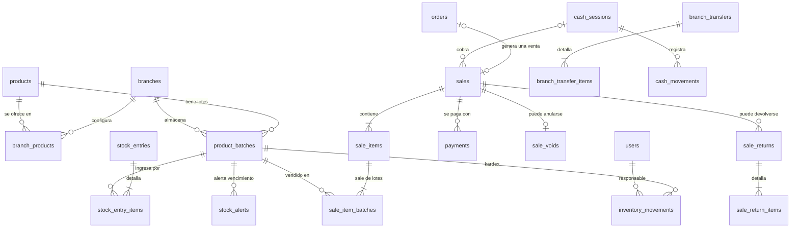
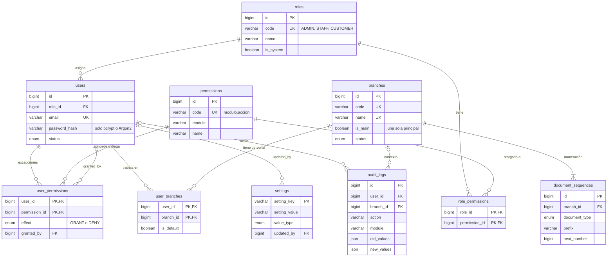
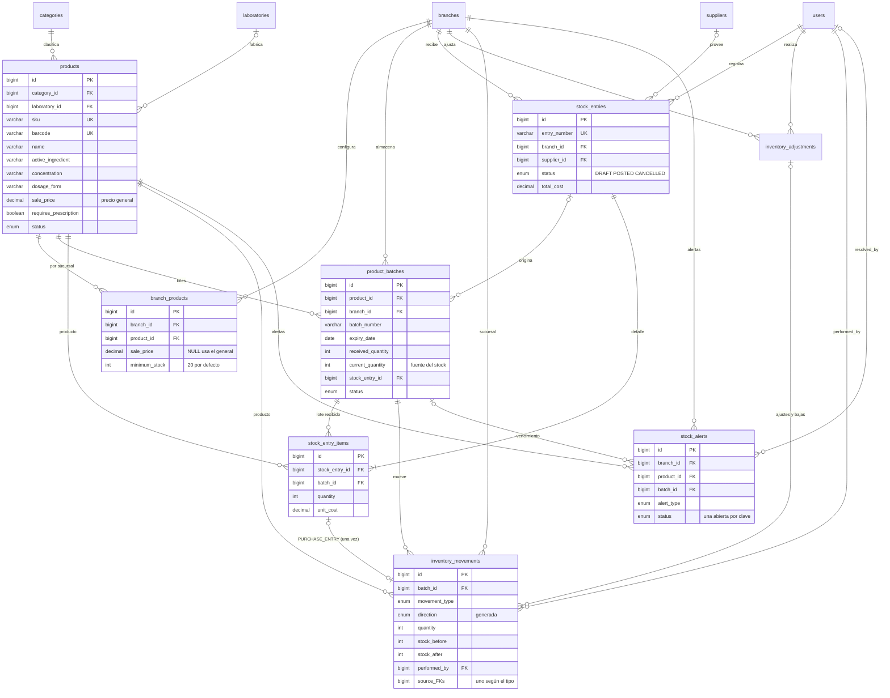
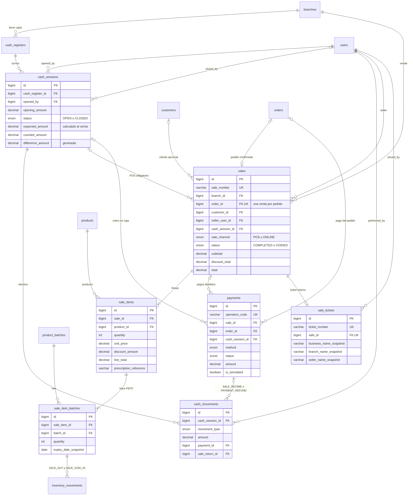
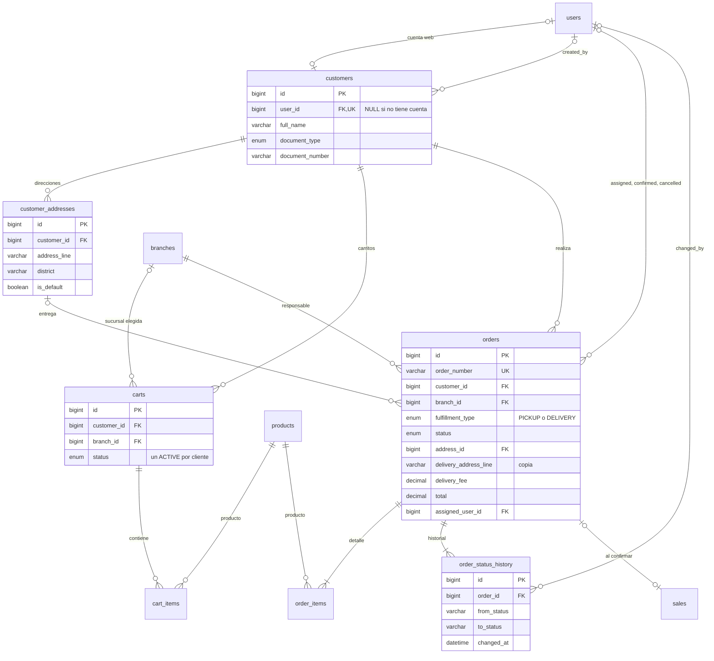
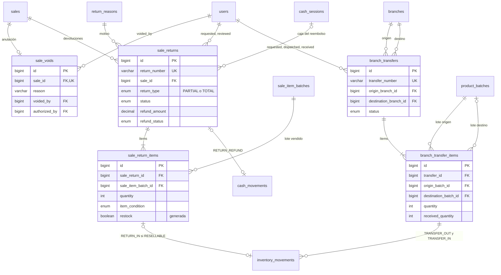

# Diagrama entidad-relación — Pharma Plus (`pharma_plus`)

Modelo de **42 tablas**, **103 claves foráneas** y **17 vistas** para MySQL 8. Para que sea legible, el modelo se presenta en una vista general y luego por módulos. Todas las relaciones coinciden con las FK reales de `pharma_plus_mysql8.sql` (ver `DICCIONARIO_DATOS.md`).

**Lectura de cardinalidades (notación pata de gallo de Mermaid)**

| Símbolo | Significado |
|---|---|
| `\|\|--o{` | uno a cero o muchos |
| `\|\|--\|{` | uno a uno o muchos |
| `\|o--o{` | cero o uno a cero o muchos (FK opcional) |
| `\|\|--o\|` | uno a cero o uno (FK única) |

---

## 1. Vista general

Las flechas resumen el flujo principal: catálogo único → configuración por sucursal → lotes → kardex, y cómo ventas, pedidos, devoluciones y transferencias afectan al inventario **solo** a través de `inventory_movements`.

---

## 2. Seguridad, sucursales y configuración

---

## 3. Catálogo, proveedores, lotes e inventario

`inventory_movements` además referencia, de forma excluyente según `movement_type`, a `sale_item_batches`, `sale_return_items` y `branch_transfer_items` (ver secciones 4 y 6). Un CHECK obliga a que exista exactamente un documento de origen.

---

## 4. Ventas, pagos, tickets y caja

---

## 5. Tienda virtual: clientes, carrito y pedidos

---

## 6. Anulaciones, devoluciones y transferencias

---

## 7. Cardinalidades clave y reglas que las garantizan

| Relación | Cardinalidad | Cómo se garantiza en la BD |
|---|---|---|
| Producto ↔ Sucursal | N:M vía `branch_products` | `UNIQUE (branch_id, product_id)`; el catálogo no se duplica |
| Producto + Sucursal → Lotes | 1:N | `UNIQUE (branch_id, product_id, batch_number)` |
| Pedido → Venta | 1:0..1 | `sales.order_id UNIQUE`; trigger exige pedido `PENDING` |
| Venta → Anulación | 1:0..1 | `sale_voids.sale_id UNIQUE` |
| Venta → Ticket | 1:0..1 | `sale_tickets.sale_id UNIQUE` |
| Línea de entrada → Movimiento | 1:0..1 | `UNIQUE (stock_entry_item_id)` |
| Lote vendido → Movimiento | 1:0..1 por tipo | `UNIQUE (sale_item_batch_id, movement_type)` |
| Ítem devuelto → Movimiento | 1:0..1 | `UNIQUE (sale_return_item_id)` |
| Ítem transferido → Movimiento | 1:0..1 por tipo | `UNIQUE (transfer_item_id, movement_type)` |
| Caja → Sesión abierta | 1:0..1 | `UNIQUE (cash_register_id, open_flag)` |
| Trabajador → Sesión abierta | 1:0..1 | `UNIQUE (opened_by, open_flag)` |
| Cliente → Carrito activo | 1:0..1 | `UNIQUE (customer_id, active_flag)` |
| Alerta abierta por producto/sucursal/tipo/lote | 0..1 | `UNIQUE (branch_id, product_id, alert_type, batch_key, open_flag)` |
| Sistema → Sucursal principal | exactamente 1 | `UNIQUE (main_flag)` + dato inicial |
