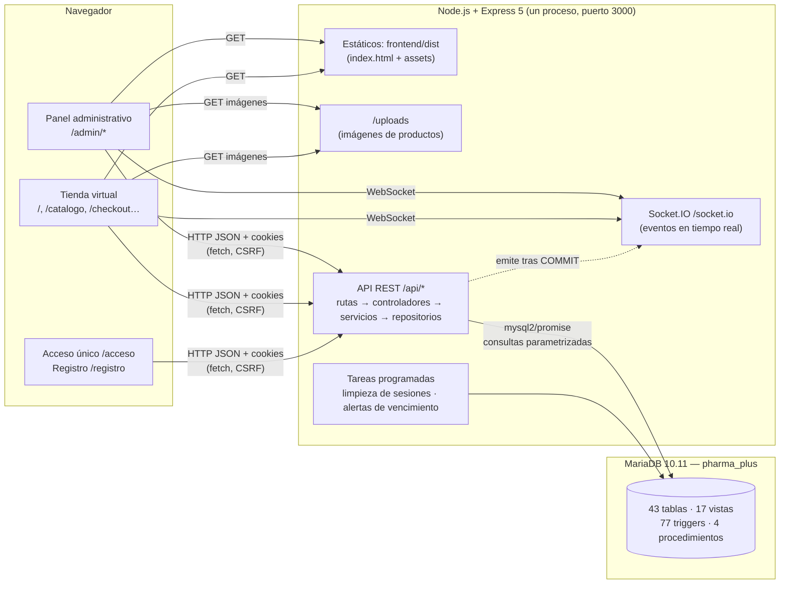
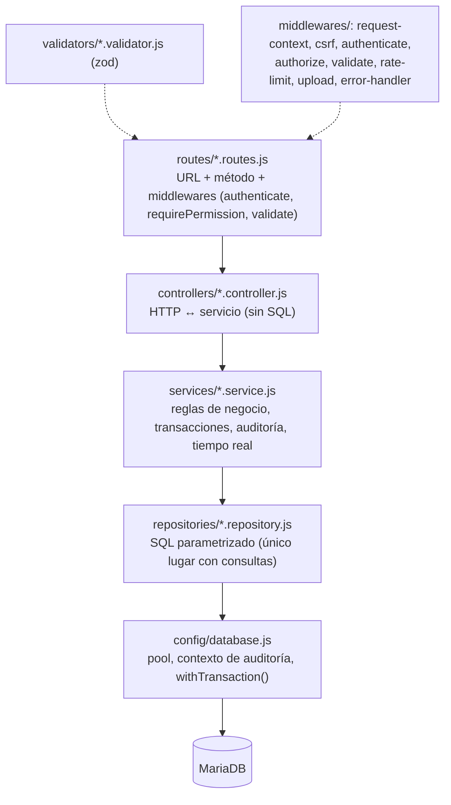
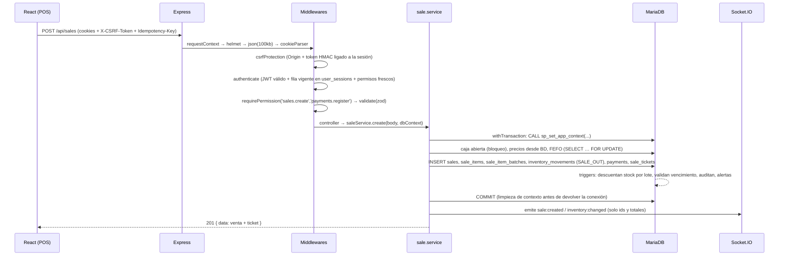
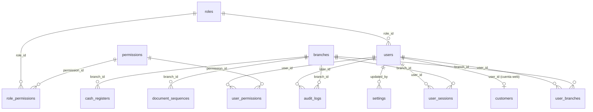
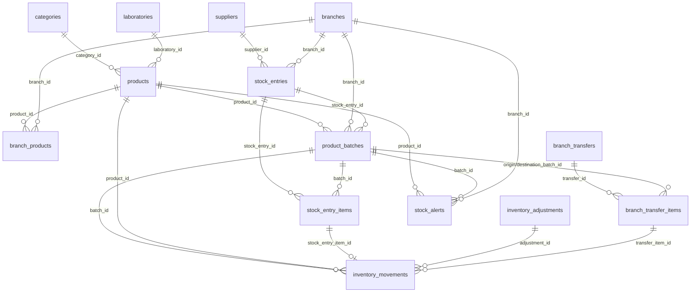
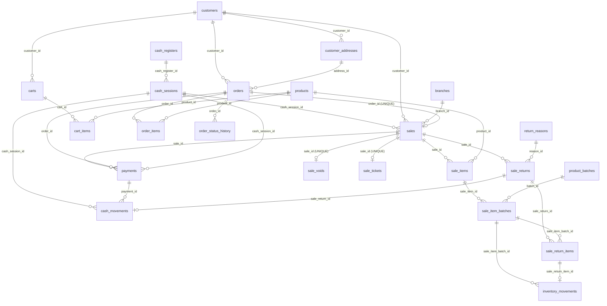
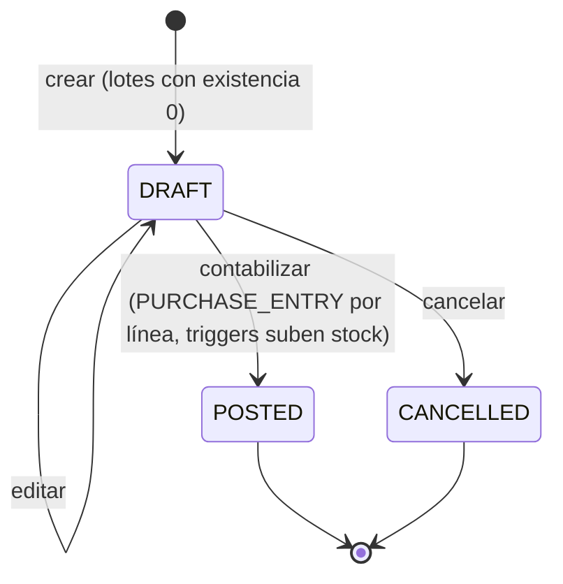
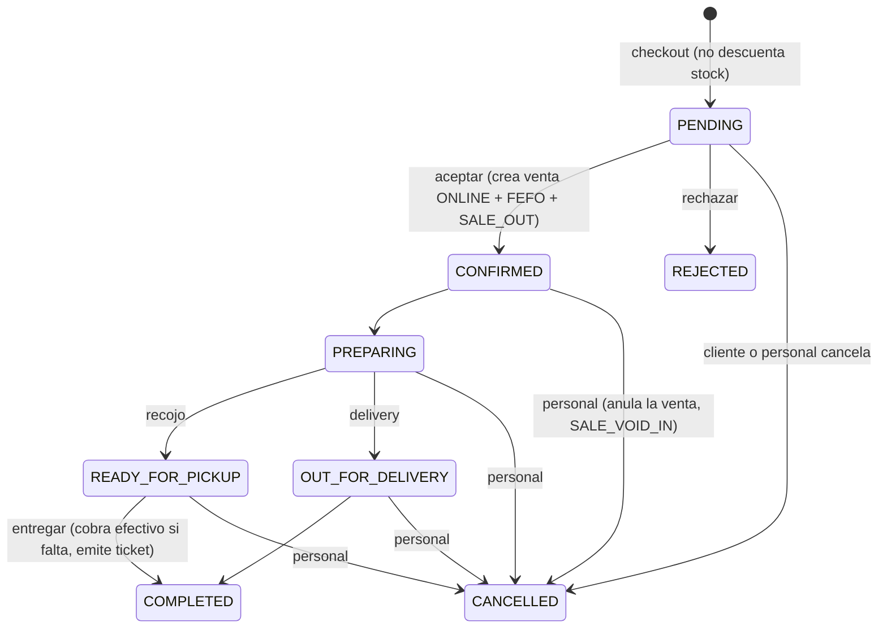
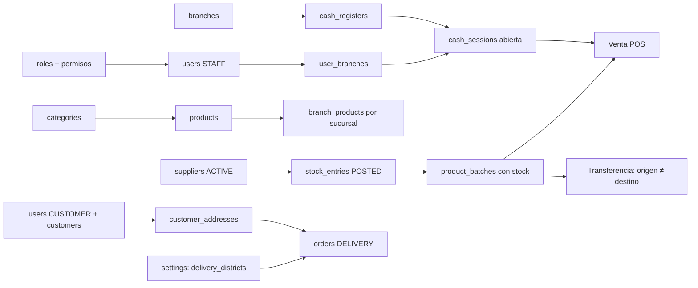

# PHARMA PLUS

## Sistema web integral para la gestión de una botica: panel administrativo y tienda virtual

**Documento técnico para exposición y defensa del proyecto**

| Campo | Valor |
|---|---|
| Sistema | Pharma Plus — "Tu salud, nuestra prioridad" |
| Tipo de documento | Auditoría técnica, documentación de arquitectura y guía de exposición |
| Versión del proyecto | `0.1.0` (`package.json`) |
| Fecha de la auditoría | 11 de noviembre de 2026 |
| Repositorio | GitHub, rama local con 2 commits (`bc4c38a`, `1f64361`) y cambios pendientes de commit |
| Autor(es) / institución / curso | *Por completar por el expositor* |

> **Cómo se elaboró este documento.** Todas las afirmaciones se obtuvieron inspeccionando el código fuente (`src/`, `frontend/`, `scripts/`, `tests/`), los archivos de configuración, la documentación del repositorio (`README.md`, `database/*.md`) y el esquema **real** de la base `pharma_plus` mediante consultas de **solo lectura** a `information_schema` y conteos (`SELECT COUNT(*)`). No se modificó código, datos, usuarios ni permisos. Los datos que no se pudieron verificar se marcan como **"Por confirmar"**. No se incluyen contraseñas, secretos, valores de variables de entorno ni datos personales.

---

## Índice

1. [Resumen ejecutivo](#1-resumen-ejecutivo)
2. [Arquitectura del sistema](#2-arquitectura-del-sistema)
3. [Tecnologías y herramientas](#3-tecnologías-y-herramientas)
4. [Módulos y funcionalidades](#4-módulos-y-funcionalidades)
5. [Base de datos](#5-base-de-datos)
6. [API y comunicación](#6-api-y-comunicación)
7. [Procesos principales de negocio](#7-procesos-principales-de-negocio)
8. [Seguridad](#8-seguridad)
9. [Preparación de datos para la exposición](#9-preparación-de-datos-para-la-exposición)
10. [Pruebas y calidad](#10-pruebas-y-calidad)
11. [Instalación y despliegue](#11-instalación-y-despliegue)
12. [Documentación para defender el proyecto](#12-documentación-para-defender-el-proyecto)
13. [Ficha técnica resumida](#13-ficha-técnica-resumida)
14. [Conclusiones](#14-conclusiones)
15. [Anexo: verificación y puntos por confirmar](#15-anexo-verificación-y-puntos-por-confirmar)

---

## 1. Resumen ejecutivo

**Pharma Plus** es un sistema web para una botica (farmacia de barrio) que integra en una sola aplicación:

- **Panel administrativo** (`/admin`) para el personal: punto de venta (POS), caja, ventas, devoluciones, pedidos online, inventario por lotes con método **FEFO** (*First Expired, First Out*), entradas de mercadería, ajustes y bajas, transferencias entre sucursales, kardex, alertas de stock y vencimiento, catálogo, proveedores, clientes, trabajadores, roles y permisos, sucursales, configuración y reportes.
- **Tienda virtual** (`/`) para clientes: catálogo público, ficha de producto, carrito, checkout con recojo o delivery, pagos simulados (modo DEMO), seguimiento de pedidos en tiempo real y gestión de la cuenta.
- **Acceso único** (`/acceso`) y **registro de clientes** (`/registro`).

Datos verificados del sistema:

| Indicador | Valor real |
|---|---|
| Arquitectura | Monolito modular cliente-servidor: SPA React + API REST Express + MariaDB, servidos en un único proceso y puerto |
| Backend | Node.js (probado en v24.21.0) + Express 5.3.0, organizado en rutas → controladores → servicios → repositorios |
| Frontend | React 18.3.1 + React Router 6.30.6, compilado con Vite 6.4.6 |
| Base de datos | MariaDB 10.11.16, base `pharma_plus`: **43 tablas, 17 vistas, 4 procedimientos almacenados, 77 triggers, 105 claves foráneas, 87 restricciones CHECK** |
| API | **156 endpoints** bajo `/api`, agrupados en 19 módulos de rutas |
| Pantallas | **23 vistas** en el panel administrativo + **10 páginas** públicas/cliente (8 de tienda, acceso y registro) |
| Seguridad | JWT HS256 en cookie HttpOnly, sesiones persistentes revocables, bcrypt, CSRF firmado con HMAC, 48 permisos y 3 roles de sistema |
| Pruebas | `node:test` + Supertest + Puppeteer-core: 4 archivos unitarios, 19 de integración y 7 E2E |

**Idea central para la defensa:** el sistema protege la integridad del inventario y del dinero en **tres capas**: el navegador nunca calcula precios; el backend valida, recalcula y opera dentro de transacciones; y la base de datos impone las reglas finales con triggers, restricciones y claves foráneas (por ejemplo, el stock **nunca** se modifica con `UPDATE`: solo cambia insertando movimientos de inventario).

---

## 2. Arquitectura del sistema

### 2.1 Arquitectura general

Pharma Plus sigue una arquitectura **cliente-servidor en tres capas** desplegada como un **monolito modular**:

1. **Capa de presentación:** una SPA (*Single Page Application*) en React con dos portales (panel y tienda) y un acceso común.
2. **Capa de aplicación:** una API REST en Node.js/Express, que además sirve los archivos compilados del frontend, las imágenes subidas y el canal de tiempo real (Socket.IO) **en el mismo puerto**.
3. **Capa de datos:** MariaDB con un esquema que contiene lógica de integridad (triggers, vistas, procedimientos).



### 2.2 Arquitectura del frontend

Ubicación: `frontend/` (entrada `frontend/index.html`, código en `frontend/src/`).

| Carpeta / archivo | Responsabilidad |
|---|---|
| `main.jsx`, `App.jsx` | Arranque y enrutador raíz: `/acceso` → acceso, `/registro` → registro, `/ingresar` → redirección heredada, `/admin/*` → panel, resto → tienda. Cada portal se carga **bajo demanda** con `React.lazy` |
| `core/api-client.js` | Cliente HTTP único (`fetch`): envía cookies (`credentials: 'same-origin'`) y la cabecera `X-CSRF-Token` en peticiones que modifican datos |
| `core/format.js`, `core/permissions.js`, `core/redirect.js` | Funciones puras: formato de dinero/fechas, evaluación de permisos del menú, validación segura de `?next=` |
| `components/` | Biblioteca de UI propia: `ui.jsx` (botones, tablas, paginación, estados), `form.jsx` (formularios declarativos), `modal.jsx`, `toast.jsx`, `charts.jsx` (gráficos SVG propios, sin librerías), `icons.jsx`, `ProductImage.jsx` (imagen de producto con alternativas) |
| `access/` | Acceso único y registro (`AccessLayout`, `AccessPage`, `RegisterPage`, tema claro/oscuro) |
| `admin/` | Panel: `AdminApp.jsx` (sesión, layout, tiempo real), `nav.js` (menú por permisos), `routes.js` (23 rutas), `views/*.jsx` (vistas cargadas bajo demanda) |
| `store/` | Tienda: `StoreApp.jsx` (sesión, sucursal, carrito, 8 rutas), `chrome.jsx` (cabecera, menú, pie), `views.jsx` (páginas) |
| `styles/` | `app.css` (sistema de diseño base) y `store.css` (tienda) |

Patrón de estado: **React Context** (`admin/context.jsx`, `store/context.jsx`) + hooks propios (`useAsync`, `useDebouncedCallback`). No se usa Redux ni otra librería de estado.

### 2.3 Arquitectura del backend

Ubicación: `src/`. Organización **en capas** con responsabilidades separadas:



| Capa | Archivos | Ejemplo |
|---|---|---|
| Arranque | `src/server.js`, `src/app.js` | `createApp()` registra middlewares, `/api`, `/uploads`, `frontend/dist` y la ruta comodín que devuelve `index.html` |
| Configuración | `src/config/env.js`, `logger.js`, `database.js` | Validación de variables de entorno; el servidor **no arranca** si los secretos son cortos o iguales o si `DB_USER=root` |
| Rutas | 10 archivos en `src/routes/` | `productsRouter.post('/', requirePermission('products.create'), validate(vc.productCreate), products.create)` |
| Middlewares | 8 archivos | CSRF, autenticación, autorización, validación zod, límite de peticiones, subida de imágenes, errores |
| Controladores | 7 archivos | Traducen la petición validada a una llamada de servicio y devuelven `{ data }` |
| Servicios | 27 archivos | `sale.service.js`, `order.service.js`, `inventory.service.js`, `auth.service.js`… |
| Repositorios | 26 archivos | Único lugar con SQL; siempre consultas parametrizadas |
| Validadores | 7 archivos (zod) | Esquemas de entrada por módulo |
| Utilidades | 9 archivos | `AppError`, cookies, dinero en céntimos, fechas, almacenamiento de imágenes, traducción de errores de MariaDB |

### 2.4 Arquitectura de la API

- Estilo **REST** sobre JSON, prefijo único `/api` (`src/routes/index.js`).
- Recursos en plural (`/products`, `/sales`, `/orders`) y **acciones de negocio como subrecursos POST** cuando representan una transición de estado (`/sales/:id/void`, `/orders/:id/accept`, `/inventory/entries/:id/post`).
- Respuestas: `{ data }` para un recurso, `{ data, pagination }` para listados paginados (máximo 100 por página), y errores con forma uniforme `{ error: { code, message, details?, requestId } }`.
- Importes monetarios como **texto decimal** (`"12.50"`) para no perder precisión.
- Idempotencia mediante la cabecera `Idempotency-Key` en ventas y pedidos.

### 2.5 Arquitectura de la base de datos

MariaDB 10.11 con motor **InnoDB** (transaccional) en todas las tablas, `utf8mb4_unicode_ci`, zona horaria `-05:00` (Lima) y `sql_mode` estricto. El esquema concentra reglas críticas:

- **Triggers (77):** recalculan stock por lote, impiden stock negativo y venta de lotes vencidos, generan alertas, calculan totales, registran auditoría e **impiden borrar** registros históricos (ventas, kardex, auditoría, usuarios…).
- **Vistas (17):** consultas reutilizables, por ejemplo stock por sucursal (`vw_branch_product_stock`), permisos efectivos (`vw_user_effective_permissions`), lotes FEFO (`vw_fefo_batches`), kardex (`vw_kardex`).
- **Procedimientos (4):** `sp_set_app_context` (contexto de auditoría en la conexión), `sp_audit`, `sp_next_document_number` (numeración de documentos por sucursal) y `sp_refresh_expiry_alerts` (alertas de vencimiento).

### 2.6 Comunicación entre frontend, backend y base de datos

| Canal | Tecnología | Uso |
|---|---|---|
| HTTP/JSON | `fetch` → Express | Todas las operaciones de negocio |
| Cookies | `pp_session` (HttpOnly, JWT) y `pp_csrf` (legible por JS) | Sesión y protección CSRF; nunca se guarda el token en `localStorage` |
| WebSocket | Socket.IO (`/socket.io`) autenticado con la cookie de sesión | Avisos en vivo: `sale:created`, `sale:voided`, `inventory:changed`, `alerts:changed`, `cash:opened`, `cash:closed`, `cash:movement`, `order:created`, `order:status`, `transfer:dispatched`, `transfer:received` |
| SQL | `mysql2/promise`, pool de conexiones | Consultas parametrizadas, una sentencia por llamada |

En desarrollo, Vite (puerto 5173) reenvía `/api`, `/uploads` y `/socket.io` al servidor Express (`frontend/vite.config.js`), de modo que las cookies funcionan igual que en producción.

### 2.7 Flujo de una solicitud HTTP (de la interfaz a la base y de regreso)

Ejemplo real: **el cajero registra una venta en el POS** (`POST /api/sales`).



Pasos en lenguaje simple:

1. La vista arma el carrito; el **precio mostrado viene de una cotización del servidor** (`POST /api/sales/quote`).
2. `api-client.js` envía la petición con la cookie de sesión y el token CSRF.
3. Express registra un id de petición, aplica cabeceras de seguridad y limita el cuerpo a 100 kb.
4. Se verifica CSRF, se autentica la sesión contra la base y se comprueban los permisos.
5. zod valida y normaliza el cuerpo; si falla responde `400 VALIDATION_ERROR`.
6. El servicio abre una transacción, fija el contexto de auditoría y ejecuta las reglas de negocio.
7. Los repositorios ejecutan SQL parametrizado; los triggers aplican las reglas finales.
8. Tras el `COMMIT` se emiten eventos en tiempo real y se responde JSON.
9. Ante un error, el manejador central responde sin exponer SQL ni trazas.

### 2.8 Patrones de diseño presentes (verificados en el código)

| Patrón | Dónde | Evidencia |
|---|---|---|
| Arquitectura en capas | `src/routes`, `controllers`, `services`, `repositories` | Cada capa solo llama a la inferior |
| Repository | `src/repositories/*.repository.js` | Único lugar con SQL |
| Middleware / cadena de responsabilidad | `src/middlewares/*` | `authenticate → requirePermission → validate → controller` |
| Unit of Work (transacción) | `withTransaction()` en `src/config/database.js` | Todo o nada; reintento ante deadlock (errno 1213/1205) |
| Factory | `createApp()` en `src/app.js`; fábrica de routers de catálogo en `catalog.routes.js` | Mismo conjunto de rutas para categorías y laboratorios |
| Publicador/suscriptor | `realtime.service.js` (Socket.IO, salas `branch:<id>`, `user:<id>`) | Eventos tras COMMIT |
| Idempotencia | `Idempotency-Key` en ventas y pedidos | Un reintento devuelve la misma venta (`idempotentReplay: true`) |
| Snapshot | Columnas `*_snapshot` en ventas, pedidos y tickets | El histórico no cambia si cambia el producto |
| Lazy loading | `React.lazy` por portal y por vista | Cada pantalla se descarga solo al abrirla |
| Context (React) | `admin/context.jsx`, `store/context.jsx` | Sesión, permisos, sucursal y carrito compartidos |

**Resumen de la sección 2:** monolito modular de tres capas; frontend y API en el mismo origen; backend en capas con transacciones y auditoría; la base impone las reglas críticas mediante triggers y restricciones.

---

## 3. Tecnologías y herramientas

### 3.1 Inventario tecnológico de producción

Versiones obtenidas de `node_modules/*/package.json` (instaladas) y del servidor de base de datos.

| Tecnología | Versión | Función | Dónde se usa | Justificación |
|---|---|---|---|---|
| JavaScript (ES2022+, CommonJS en backend, ESM en frontend) | — | Lenguaje único del sistema | `src/`, `frontend/src/`, `scripts/`, `tests/` | Un solo lenguaje en cliente y servidor |
| JSX | — | Plantillas de componentes React | `frontend/src/**/*.jsx` | Interfaz declarativa |
| SQL (dialecto MariaDB) | — | Esquema, triggers, vistas, procedimientos | `database/*.sql` | Reglas de integridad en la base |
| CSS3 | — | Estilos, temas claro/oscuro, responsive | `frontend/src/styles/`, `access/access.css`, `admin/*.css` | Sin framework CSS: control total del diseño |
| Node.js | Requisito `>=20` (`engines`); probado en **24.21.0** | Entorno de ejecución del servidor | `src/server.js` | E/S asíncrona, mismo lenguaje que el frontend |
| Express | **5.3.0** | Servidor HTTP y enrutamiento | `src/app.js`, `src/routes/` | Estándar de facto; v5 propaga errores async al manejador central |
| mysql2 | **3.24.6** | Conector MariaDB con promesas y pool | `src/config/database.js` | Consultas parametrizadas, transacciones |
| MariaDB | **10.11.16** | Gestor de base de datos relacional | Base `pharma_plus` (vía XAMPP) | Transacciones InnoDB, triggers, vistas, CHECK |
| zod | **4.6.7** | Validación de datos de entrada | `src/validators/`, rutas | Esquemas declarativos y mensajes en español |
| jsonwebtoken | **9.0.3** | Firma/verificación del token de sesión (HS256) | `src/services/token.service.js` | Token firmado dentro de cookie HttpOnly |
| bcryptjs | **3.0.3** | Hash de contraseñas | `src/services/password.service.js` | Algoritmo lento y con sal, costo configurable (por defecto 12) |
| helmet | **8.3.0** | Cabeceras de seguridad (CSP, frame-ancestors, etc.) | `src/app.js` | Mitiga XSS, clickjacking, sniffing |
| cookie-parser | **1.4.7** | Lectura de cookies | `src/app.js` | Sesión y CSRF por cookies |
| express-rate-limit | **8.7.3** | Límite de intentos | `src/middlewares/rate-limit.js` | Freno a fuerza bruta en login y registro |
| multer | **2.5.0** | Subida de imágenes (multipart, en memoria) | `src/middlewares/upload.js` | Se valida la firma binaria antes de escribir en disco |
| socket.io | **4.8.4** | Tiempo real | `src/services/realtime.service.js` | Pedidos, inventario y caja en vivo |
| pino / pino-http | **10.4.0** / **11.0.0** | Registro estructurado | `src/config/logger.js`, `src/app.js` | Rápido y con ocultación de datos sensibles |
| dotenv | **18.0.10** | Carga de variables de entorno | `src/config/env.js` | Secretos fuera del código |
| React / React DOM | **18.3.1** | Biblioteca de interfaz | `frontend/src/` | Componentes, hooks, contexto |
| React Router DOM | **6.30.6** | Enrutamiento del lado del cliente | `App.jsx`, `AdminApp.jsx`, `StoreApp.jsx` | URLs limpias (`/admin/pos`, `/producto/5`) |
| socket.io-client | **4.8.4** | Cliente de tiempo real | Panel y tienda | Misma cookie de sesión |

> React, React Router y socket.io-client figuran en `devDependencies` porque **solo se necesitan para compilar** el frontend: en producción Express sirve el resultado ya compilado en `frontend/dist`.

### 3.2 Herramientas de desarrollo, construcción y pruebas

| Herramienta | Versión | Uso |
|---|---|---|
| Vite | **6.4.6** | Compilación del frontend (`npm run build`) y servidor de desarrollo con recarga en caliente (`npm run dev:web`, puerto 5173) |
| @vitejs/plugin-react | **4.7.0** | Soporte JSX/React en Vite |
| npm | 11.19.0 (equipo de desarrollo) | Gestión de dependencias y scripts (`package-lock.json`) |
| node:test (integrado en Node.js) | — | Framework de pruebas unitarias, de integración y E2E |
| Supertest | **7.3.2** | Pruebas HTTP de la API sin abrir puertos |
| puppeteer-core | **25.16.0** | Pruebas E2E con Google Chrome real y capturas de evidencia |
| pino-pretty | **13.2.0** | Registros legibles en desarrollo |
| `node --watch` | integrado | Reinicio automático del backend (`npm run dev`) |
| XAMPP (MariaDB + phpMyAdmin) | MariaDB 10.11.16 | Servidor de base de datos local; phpMyAdmin para aplicar migraciones como root |
| Cliente `mariadb.exe` | de XAMPP | Usado por `scripts/test-tempdb.js` para crear bases temporales de prueba |
| Git | 2.55.0 | Control de versiones; remoto en GitHub |
| Visual Studio Code | Por confirmar (mencionado en `README.md` como terminal recomendada) | Editor |

### 3.3 Herramientas de diseño

- Los bocetos de interfaz originales (claro/oscuro, PC/móvil, en PNG) se conservaron **fuera del repositorio** como referencia del proceso de diseño. No forman parte de los archivos necesarios para ejecutar Pharma Plus, y la carpeta `Bocetos/` está excluida en `.gitignore`. Los logos que usa la aplicación están en `frontend/public/img/`. **La herramienta con la que se crearon los bocetos: Por confirmar.**
- Los gráficos del panel son **SVG propios** (`frontend/src/components/charts.jsx`); no se usa librería de gráficos.
- Iconografía propia en `frontend/src/components/icons.jsx` (trazos SVG).

### 3.4 Tecnologías que **no** se usan (para responder con precisión)

No hay en el proyecto: TypeScript, Redux, Tailwind/Bootstrap, ORM (Sequelize, Prisma, TypeORM), Docker, CI/CD (no existe `.github/`), servidor web externo (Nginx/Apache para la app), ni pasarela de pago real (los pagos son **simulados**, `payments.mode = DEMO`). Tampoco hay herramienta de cobertura de código configurada.

**Resumen de la sección 3:** stack JavaScript de extremo a extremo (React + Express) con MariaDB. Dependencias de producción mínimas y orientadas a seguridad; pruebas con herramientas nativas de Node.js y Chrome real.

---

## 4. Módulos y funcionalidades

### 4.1 Inventario de pantallas

**Panel administrativo — 23 vistas** (`frontend/src/admin/routes.js` y `nav.js`). El menú solo muestra lo que el usuario puede usar; el backend vuelve a validar cada acción.

| # | Ruta | Pantalla | Grupo del menú | Permiso para verla |
|---|---|---|---|---|
| 1 | `/admin/dashboard` | Dashboard | General | `reports.view` |
| 2 | `/admin/pos` | Punto de venta | Ventas | `sales.create` **y** `payments.register` |
| 3 | `/admin/cash` | Caja | Ventas | cualquiera de `cash.open/close/movements/view_all` |
| 4 | `/admin/sales` | Ventas | Ventas | `sales.view` |
| 5 | `/admin/returns` | Devoluciones | Ventas | `returns.create` o `returns.approve` |
| 6 | `/admin/orders` | Pedidos online | Ventas | `orders.view` |
| 7 | `/admin/stock` | Stock | Inventario | `inventory.view` |
| 8 | `/admin/batches` | Lotes y vencimientos | Inventario | `inventory.view` |
| 9 | `/admin/entries` | Entradas | Inventario | `inventory.view` o `inventory.entries` |
| 10 | `/admin/adjustments` | Ajustes y bajas | Inventario | `inventory.adjust`, `inventory.write_off` o `inventory.view` |
| 11 | `/admin/transfers` | Transferencias | Inventario | `inventory.transfers` o `inventory.receive_transfers` |
| 12 | `/admin/kardex` | Kardex | Inventario | `inventory.view` |
| 13 | `/admin/alerts` | Alertas | Inventario | `alerts.view` |
| 14 | `/admin/products` | Productos | Catálogo | `products.view` |
| 15 | `/admin/categories` | Categorías | Catálogo | `products.view` |
| 16 | `/admin/laboratories` | Laboratorios | Catálogo | `products.view` |
| 17 | `/admin/suppliers` | Proveedores | Catálogo | `suppliers.view` |
| 18 | `/admin/customers` | Clientes | Administración | `customers.view` |
| 19 | `/admin/users` | Trabajadores | Administración | `users.view` |
| 20 | `/admin/roles` | Roles y permisos | Administración | `roles.manage` |
| 21 | `/admin/branches` | Sucursales | Administración | `branches.manage` |
| 22 | `/admin/reports` | Reportes | Administración | `reports.view` |
| 23 | `/admin/settings` | Configuración | Administración | `settings.manage` |

**Tienda virtual y acceso — 10 páginas** (`frontend/src/store/StoreApp.jsx`, `App.jsx`):

| Ruta | Página | Requiere sesión de cliente |
|---|---|---|
| `/` | Inicio (banner, beneficios, categorías, productos destacados) | No |
| `/catalogo` | Catálogo con búsqueda, categorías, orden y filtro "solo con stock" | No |
| `/producto/:id` | Detalle del producto | No |
| `/carrito` | Carrito | Sí |
| `/checkout` | Finalizar compra (recojo/delivery, dirección, receta, método de pago DEMO) | Sí |
| `/pedidos` | Mis pedidos | Sí |
| `/pedidos/:id` | Seguimiento del pedido en vivo y cancelación mientras está pendiente | Sí |
| `/cuenta` | Datos personales, direcciones y contraseña | Sí |
| `/acceso` | Acceso único (personal y clientes) | No |
| `/registro` | Registro de clientes | No |

`/ingresar` se conserva solo como redirección a `/acceso`.

### 4.2 Roles del sistema

Datos reales de `roles`, `role_permissions` y `permissions` (48 permisos en 14 módulos):

| Rol | Permisos | Descripción |
|---|---|---|
| `ADMIN` | 44 (todos menos los 4 `store.*`) | Administración total, todas las sucursales (`branches.manage`) |
| `STAFF` | 20 | Operación diaria: POS, caja (abrir, cerrar, movimientos), ventas, pedidos, devoluciones (solo crear), entradas, recepción de transferencias, consultas de catálogo, proveedores, alertas y reportes |
| `CUSTOMER` | 4 (`store.browse`, `store.cart`, `store.orders`, `store.profile`) | Cliente de la tienda; no accede a ninguna API administrativa |

Además, cada trabajador puede recibir permisos individuales `GRANT` o `DENY` (tabla `user_permissions`). Los permisos efectivos se calculan en la vista `vw_user_effective_permissions` (rol + GRANT − DENY). Desde el panel se pueden crear roles nuevos; `ADMIN` y `CUSTOMER` están protegidos.

### 4.3 Módulos del panel administrativo

Para cada módulo: objetivo, funciones, usuarios, datos, tablas, endpoints, proceso, validaciones y relación con otros módulos.

#### 4.3.1 Dashboard
- **Objetivo:** visión rápida del negocio del día.
- **Funciones:** KPI (ventas, pedidos, stock bajo, lotes por vencer en 30 días, alertas abiertas y agotados), ventas por día, productos más vendidos, métodos de pago, últimos vencimientos y alertas, actividad.
- **Usuarios:** ADMIN y STAFF (`reports.view`).
- **Tablas/vistas:** `sales`, `sale_items`, `payments`, `orders`, `vw_branch_product_stock`, `vw_products_low_stock`, `product_batches`, `stock_alerts`.
- **Endpoint:** `GET /api/reports/dashboard`.
- **Relación:** resume ventas, pedidos, inventario y alertas.

#### 4.3.2 Punto de venta (POS)
- **Objetivo:** vender en mostrador.
- **Funciones:** búsqueda por nombre/SKU/código de barras (lector), carrito con **cotización del servidor**, referencia de receta, cliente opcional, descuento (con permiso), pago simple o mixto (efectivo, tarjeta, transferencia, Yape, Plin, todos menos efectivo simulados), cálculo de vuelto, ticket interno.
- **Usuarios:** quien tenga `sales.create` + `payments.register` y una **caja abierta**.
- **Tablas:** `sales`, `sale_items`, `sale_item_batches`, `inventory_movements`, `payments`, `cash_movements` (trigger), `sale_tickets`, `customers`.
- **Endpoints:** `GET /api/sales/catalog`, `POST /api/sales/quote`, `POST /api/sales`.
- **Validaciones:** cantidad entera 1–100 000; 1 a 6 pagos; los pagos deben sumar exactamente el total; descuento ≤ `sales.max_discount_percent`; receta obligatoria si `sales.require_prescription_reference = true`; stock suficiente por FEFO; lotes no vencidos.
- **Relación:** caja, inventario, ventas, clientes, tickets, reportes.

#### 4.3.3 Caja
- **Objetivo:** controlar el efectivo por turno.
- **Funciones:** abrir sesión con monto inicial, ingresos/egresos (`CASH_IN`/`CASH_OUT`), cierre con arqueo (monto contado) e historial.
- **Tablas:** `cash_registers`, `cash_sessions`, `cash_movements`, `vw_cash_session_summary`.
- **Endpoints:** `/api/cash/registers`, `/api/cash/sessions` (GET/POST), `/sessions/current`, `/sessions/:id`, `/sessions/:id/close`, `/api/cash/movements`.
- **Reglas:** una sesión abierta por caja y por trabajador; el trabajador debe estar asignado a la sucursal; el **saldo esperado lo calcula un trigger** y la diferencia es una columna generada; una caja cerrada no se reabre; sin `cash.view_all` cada trabajador solo ve sus sesiones.

#### 4.3.4 Ventas
- **Funciones:** listado y filtros, detalle (líneas, lotes FEFO usados, pagos), ticket imprimible (HTML) y reimpresión con contador, **anulación** con motivo.
- **Tablas:** `sales`, `sale_items`, `sale_item_batches`, `payments`, `sale_tickets`, `sale_voids`.
- **Endpoints:** `GET /api/sales`, `GET /api/sales/:id`, `POST /api/sales/:id/void`, `GET|POST /api/sales/:id/ticket`, `POST /api/sales/:id/ticket/print`, `GET /api/payments`.
- **Reglas:** anular exige `sales.void` (y `payments.refund` si hay pagos aprobados); repone stock con `SALE_VOID_IN`; no se anula una venta con devoluciones.

#### 4.3.5 Devoluciones
- **Funciones:** buscar venta por número de ticket o de venta, ver lo vendido/devuelto/disponible por lote, solicitar, aprobar, rechazar y completar con reembolso.
- **Tablas:** `sale_returns`, `sale_return_items`, `return_reasons` (7 motivos), `inventory_movements` (`RETURN_IN`), `cash_movements` (`RETURN_REFUND`).
- **Endpoints:** `/api/returns/reasons`, `/lookup`, `/sales/:id`, `GET/POST /api/returns`, `/:id/approve`, `/:id/reject`, `/:id/complete`.
- **Reglas:** no devolver más de lo vendido (bloqueo `FOR UPDATE` de la venta); solo las unidades `RESELLABLE` reingresan al **mismo lote**; el reembolso sale por un medio usado en la venta.

#### 4.3.6 Pedidos online
- **Funciones:** bandeja por estado con actualización en vivo, revisión de receta, aceptar/rechazar, preparar, listo para recojo o en reparto, completar (cobra efectivo si falta), cancelar, asignar a un trabajador.
- **Tablas:** `orders`, `order_items`, `order_status_history`, `payments`, `sales` (al aceptar se crea la venta `ONLINE`).
- **Endpoints:** `GET /api/orders`, `GET /api/orders/:id`, `POST /api/orders/:id/{accept|reject|prepare|ready|complete|cancel|assign}`.

#### 4.3.7 Inventario: Stock, Lotes y vencimientos, Kardex
- **Stock:** existencias por sucursal (física, disponible, vencida, bloqueada, mínimo, máximo, estado `OK`/`LOW_STOCK`/`OUT_OF_STOCK`). Vista `vw_branch_product_stock`. `GET /api/inventory`, `/low-stock`.
- **Lotes:** número de lote, fechas, cantidades, costo y estado de vigencia (`vw_batch_expiry_status`). `GET /api/inventory/batches[/:id]`, `GET /api/inventory/fefo`.
- **Kardex:** historial de movimientos con stock antes/después por producto y por lote (`vw_kardex`). `GET /api/inventory/movements`.

#### 4.3.8 Entradas de mercadería
- **Funciones:** crear entrada (borrador o contabilizada directamente), editar borrador, contabilizar, cancelar.
- **Tablas:** `stock_entries`, `stock_entry_items`, `product_batches`, `inventory_movements` (`PURCHASE_ENTRY`), `suppliers`.
- **Endpoints:** `GET/POST /api/inventory/entries`, `GET/PUT /entries/:id`, `POST /entries/:id/post`, `POST /entries/:id/cancel`.
- **Validaciones:** proveedor activo; lote con vencimiento futuro; comprobante (proveedor + tipo + número) único (`409 DUPLICATE_DOCUMENT`); contabilizar dos veces es idempotente (`alreadyPosted: true`).

#### 4.3.9 Ajustes y bajas
- **Tipos:** `PHYSICAL_COUNT` (conteo físico), `CORRECTION`, `OTHER` (permiso `inventory.adjust`) y `EXPIRED_WRITE_OFF`, `DAMAGE`, `LOSS` (permiso `inventory.write_off`).
- **Tablas:** `inventory_adjustments` (cabecera) + un movimiento por lote en `inventory_movements`.
- **Endpoints:** `GET/POST /api/inventory/adjustments`, `GET /adjustments/:id`.
- **Reglas:** en el conteo físico el servidor bloquea el lote, lee el stock real y solo registra la diferencia; `EXPIRED_WRITE_OFF` solo para lotes vencidos; motivo mínimo de 5 caracteres.

#### 4.3.10 Transferencias entre sucursales
- **Flujo:** solicitud → aprobación → despacho (`TRANSFER_OUT`) → recepción total o parcial (`TRANSFER_IN`) con diferencias (faltantes, dañados dados de baja, sobrantes documentados) → o cancelación antes del despacho.
- **Tablas:** `branch_transfers`, `branch_transfer_items`, `product_batches`, `inventory_movements`.
- **Endpoints:** `/api/inventory/transfers` (GET/POST), `/:id` (GET/PUT), `/:id/approve`, `/:id/dispatch`, `/:id/receive`, `/:id/cancel`.
- **Nota:** requiere **al menos dos sucursales**; hoy la base tiene una sola (ver sección 9).

#### 4.3.11 Alertas
- **Tipos:** `LOW_STOCK`, `OUT_OF_STOCK` (generadas por triggers al cambiar el stock), `EXPIRING_SOON`, `EXPIRED` (procedimiento `sp_refresh_expiry_alerts` según `inventory.expiry_alert_days` = 90).
- **Funciones:** listar, ver, cerrar (`RESOLVED`/`DISMISSED`), recalcular vencimientos.
- **Endpoints:** `GET /api/inventory/alerts[/:id]`, `POST /alerts/:id/close`, `POST /alerts/refresh-expiry`.
- **Automatización:** recálculo diario a las 06:00 (hora de Lima) con bloqueo `GET_LOCK` para no solaparse.

#### 4.3.12 Catálogo: Productos, Categorías, Laboratorios
- **Productos:** alta, edición, precios generales y por sucursal, mínimo/máximo por sucursal, ubicación, disponibilidad, estado (`ACTIVE`/`INACTIVE`/`DISCONTINUED`), imagen (JPG/PNG/WEBP validada por firma binaria). Validaciones: SKU `^[A-Za-z0-9._-]+$`, código de barras 4–80 caracteres, máximo ≥ mínimo.
- **Imágenes:** prioridad `imageUrl` de la API → fotografía local por ID (`components/ProductImage.jsx`, 6 productos) → marcador.
- **Categorías y laboratorios:** CRUD con activación; solo se elimina una categoría sin productos.
- **Endpoints:** `/api/products` (9 rutas), `/api/categories` y `/api/laboratories` (6 cada una).

#### 4.3.13 Proveedores
- **Funciones:** alta, edición, activación, historial de entradas del proveedor.
- **Validaciones:** RUC de 11 dígitos con **prefijo y dígito verificador SUNAT** (`isValidRuc`), correo y teléfono.
- **Endpoints:** `/api/suppliers` (GET/POST), `/:id` (GET/PUT), `/:id/status`, `/:id/entries`.

#### 4.3.14 Clientes
- **Funciones:** clientes de mostrador (sin cuenta) y clientes web (con usuario `CUSTOMER`); alta y edición.
- **Validaciones:** tipo y número de documento juntos o ninguno; DNI de 8 dígitos; RUC `^[12]\d{10}$`.
- **Endpoints:** `GET/POST /api/customers`, `GET/PUT /api/customers/:id`.

#### 4.3.15 Trabajadores, Roles y permisos, Sucursales
- **Trabajadores:** alta (con contraseña temporal que obliga a cambiarla), edición, asignación de sucursales, bloqueo, restablecer contraseña, desbloquear, permisos individuales. `/api/users` (7 rutas).
- **Roles:** listar, crear y editar la matriz de permisos. `/api/roles` (4 rutas, `roles.manage`).
- **Sucursales:** alta, edición y cajas registradoras. `/api/branches` (4 rutas, `branches.manage`).
- **Protecciones:** nadie cambia su propio rol, estado o permisos; no se puede dejar el sistema sin un ADMIN activo.

#### 4.3.16 Configuración
- **Funciones:** ver y editar las 17 claves de `settings` (moneda, zona horaria, negocio, inventario, pedidos, pagos, ventas, seguridad, leyenda del ticket). Distritos con cobertura de delivery (`orders.delivery_districts`, opcional).
- **Claves no editables por la API:** `app.timezone`, `app.utc_offset`, `app.currency`, `payments.mode`, `inventory.method`.
- **Endpoints:** `GET /api/settings`, `PUT /api/settings/:key`, `GET /api/settings/public` (sin sesión, solo valores públicos).

#### 4.3.17 Reportes
- **Reportes:** resumen de ventas, comparación entre períodos, series (día/semana/mes), top de productos, por categoría, por sucursal, por vendedor, métodos de pago, valorización de inventario, stock bajo, por vencer, movimientos, devoluciones, pedidos, caja y actividad (auditoría, con `audit.view`).
- **Endpoints:** 17 rutas bajo `/api/reports` (`reports.view`; varias sucursales a la vez con `reports.consolidated`).
- **Definiciones:** cada respuesta incluye `definitions` (ventas brutas, netas, reembolsos, costo de lo vendido, **margen bruto estimado, que no es ganancia neta**). Rango máximo de 366 días.

### 4.4 Módulos de la tienda virtual

| Módulo | Funciones | Endpoints | Tablas |
|---|---|---|---|
| Catálogo público | Sucursales, categorías, productos activos y habilitados en la sucursal; indica si hay stock **sin exponer el inventario exacto** | `GET /api/store/branches`, `/categories`, `/products`, `/products/:id` | `products`, `branch_products`, `categories`, vistas de stock |
| Registro y acceso | Alta de cliente (crea `users` con rol CUSTOMER + `customers`); acceso único | `POST /api/store/auth/register`, `POST /api/auth/access` | `users`, `customers`, `user_sessions` |
| Perfil y direcciones | Ver/editar datos; CRUD de direcciones | `GET/PUT /api/store/me`, `/me/addresses[/:id]` | `customers`, `customer_addresses` |
| Carrito | Persistente en servidor, por sucursal; cantidades 1–100 | `GET/PUT/DELETE /api/store/cart`, `PUT/DELETE /cart/items/:productId` | `carts`, `cart_items` |
| Checkout y pedidos | Recojo o delivery, receta declarada, pago DEMO o efectivo contra entrega, idempotencia, seguimiento en vivo, cancelación si `PENDING` | `POST/GET /api/store/orders`, `GET /orders/:id`, `POST /orders/:id/cancel` | `orders`, `order_items`, `order_status_history`, `payments` |

**Resumen de la sección 4:** 23 vistas administrativas agrupadas en Ventas, Inventario, Catálogo y Administración, y 10 páginas para clientes. Cada módulo tiene sus endpoints con permisos y validaciones en el backend.

---

## 5. Base de datos

### 5.1 Datos generales

| Dato | Valor verificado |
|---|---|
| Motor | MariaDB **10.11.16** (XAMPP) |
| Base | `pharma_plus` |
| Motor de almacenamiento | InnoDB en las 43 tablas |
| Juego de caracteres | `utf8mb4_unicode_ci` |
| Zona horaria de sesión | `-05:00` (Lima) |
| `sql_mode` | `STRICT_TRANS_TABLES, NO_ZERO_IN_DATE, NO_ZERO_DATE, ERROR_FOR_DIVISION_BY_ZERO, NO_ENGINE_SUBSTITUTION` |
| Tablas | **43** (42 del script base + `user_sessions` de la migración 001) |
| Vistas | 17 |
| Procedimientos | 4 |
| Triggers | 77 |
| Claves foráneas | 105 columnas con referencia |
| Restricciones CHECK | 87 |
| Índices | 192 (incluye PK, UNIQUE e índices secundarios) |
| Script de creación | `database/pharma_plus_mariadb_10_11.sql` (+ `database/migrations/001_user_sessions.sql`) |
| Documentación existente | `database/DICCIONARIO_DATOS.md`, `DIAGRAMA_ER.md`, `README_DATABASE_MARIADB.md` |

### 5.2 Tablas por área (nombre, finalidad y campos principales)

**Seguridad y usuarios (8)**

| Tabla | Finalidad | Campos principales |
|---|---|---|
| `roles` | Roles (ADMIN, STAFF, CUSTOMER y personalizados) | `code` (UNIQUE), `name`, `is_system`, `is_active` |
| `permissions` | Catálogo de 48 permisos | `code` (UNIQUE), `module`, `name` |
| `role_permissions` | Permisos de cada rol (N:M) | PK compuesta (`role_id`, `permission_id`) |
| `users` | Cuentas de personal y clientes | `email` (UNIQUE), `password_hash`, `role_id`, `status` (ACTIVE/INACTIVE/BLOCKED), `must_change_password`, `failed_login_attempts`, `locked_until` |
| `user_permissions` | Excepciones individuales | `effect` (GRANT/DENY), `reason`, `granted_by` |
| `user_branches` | Sucursales asignadas a cada trabajador | PK (`user_id`, `branch_id`), `is_default` (+ columna generada única para un solo predeterminado) |
| `user_sessions` | Sesiones persistentes revocables | `session_hash` CHAR(64) UNIQUE (SHA-256), `expires_at`, `revoked_at`, `revoked_reason` |
| `audit_logs` | Bitácora de auditoría | `action`, `module`, `entity_table`, `entity_id`, `old_values`/`new_values` (JSON), `ip_address`, `request_id`, `created_at` DATETIME(3) |

**Organización y configuración (4)**: `branches` (sucursales; `is_main` con columna generada única → solo una principal), `settings` (clave-valor tipado: STRING/INTEGER/DECIMAL/BOOLEAN/JSON), `document_sequences` (numeración por sucursal y tipo de documento), `return_reasons` (motivos de devolución).

**Catálogo (5)**: `categories`, `laboratories`, `products` (SKU y código de barras únicos, precios `DECIMAL(10,2)`, `requires_prescription`, `status`), `branch_products` (precio, mínimo, máximo, ubicación y disponibilidad por sucursal), `suppliers` (RUC `CHAR(11)` UNIQUE).

**Inventario (8)**: `product_batches` (lotes: número, fabricación, **vencimiento**, cantidad recibida y actual, costo, estado ACTIVE/DEPLETED/QUARANTINE/RECALLED), `inventory_movements` (kardex: 10 tipos de movimiento, dirección generada, stock antes/después por producto y por lote, enlace al documento de origen), `stock_entries` + `stock_entry_items` (entradas), `inventory_adjustments` (ajustes), `branch_transfers` + `branch_transfer_items` (transferencias), `stock_alerts` (alertas con columna generada `open_flag` para evitar duplicados abiertos).

**Ventas, caja y pagos (10)**: `cash_registers`, `cash_sessions` (`difference_amount` generado), `cash_movements`, `sales` (canal POS/ONLINE, estado COMPLETED/VOIDED, snapshots del cliente), `sale_items`, `sale_item_batches` (qué lote se vendió), `sale_voids`, `sale_tickets` (ticket interno con snapshots del negocio y `print_count`), `payments` (6 métodos, 5 estados, `is_simulated`), `sale_returns` + `sale_return_items` (`restock` generado según la condición del ítem).

**Clientes y tienda (7)**: `customers` (vinculado opcionalmente a `users`), `customer_addresses` (una predeterminada por cliente mediante columna generada), `carts` (un solo carrito ACTIVE por cliente, índice único `customer_id + active_flag`; el carrito guarda la sucursal elegida), `cart_items`, `orders` (8 estados, recojo/delivery, datos de entrega copiados), `order_items` (snapshots), `order_status_history`.

### 5.3 Diagrama entidad-relación (relaciones verificadas en `information_schema.key_column_usage`)

Para legibilidad se divide en tres diagramas; las relaciones con `users` de "quién hizo qué" (`performed_by`, `approved_by`, `created_by`…) se omiten salvo las esenciales.

**a) Seguridad y organización**



**b) Catálogo e inventario**



**c) Ventas, caja, pagos, devoluciones y tienda**



### 5.4 Cómo se mantiene la integridad y la consistencia

1. **Claves foráneas (105)** entre todas las entidades: no puede existir, por ejemplo, un movimiento de un lote inexistente.
2. **Restricciones CHECK (87)** y tipos estrictos (`UNSIGNED`, `ENUM`, `DECIMAL`) con `sql_mode` estricto: cantidades no negativas, estados válidos, montos con dos decimales.
3. **Unicidad con columnas generadas:** una sola sucursal principal (`main_flag`), un solo carrito activo por cliente (`customer_id + active_flag`), una sola sesión de caja abierta por caja y otra por trabajador (`cash_register_id + open_flag`, `opened_by + open_flag`), una sola dirección y sucursal predeterminadas, una sola alerta abierta por sucursal/producto/tipo/lote (`stock_alerts`), un lote único por sucursal/producto/número y un comprobante de proveedor único (`supplier_id + tipo + número`).
4. **Stock gobernado por movimientos:** `product_batches.current_quantity` solo cambia por los triggers de `inventory_movements`; el código **nunca** ejecuta `UPDATE` sobre cantidades (una prueba automática lo verifica). Los triggers impiden stock negativo y vender lotes vencidos.
5. **Historial inmutable:** triggers `BEFORE DELETE`/`BEFORE UPDATE` bloquean borrar o alterar ventas, kardex, auditoría, pagos, tickets y usuarios. Las anulaciones son **registros nuevos** (`sale_voids`, `SALE_VOID_IN`), no borrados.
6. **Transacciones InnoDB** con `withTransaction()`: todo o nada, bloqueos `FOR UPDATE` en lotes, caja y ventas, y reintento automático ante *deadlock*.
7. **Cálculos en la base:** totales de línea, saldo esperado de caja, diferencias y dirección de movimientos los calculan triggers o columnas generadas, no el navegador.
8. **Auditoría:** `sp_set_app_context` fija usuario, sucursal, id de petición e IP en la conexión; los triggers escriben en `audit_logs`. La conexión se limpia antes de volver al pool (o se destruye si la limpieza falla).
9. **Usuario de aplicación con mínimo privilegio:** `pharma_app` solo tiene `SELECT, INSERT, UPDATE, DELETE, EXECUTE` sobre `pharma_plus`; no puede alterar el esquema.

**Resumen de la sección 5:** esquema normalizado de 43 tablas con fuerte integridad declarativa (FK, CHECK, UNIQUE) y procedimental (77 triggers). El inventario funciona como un libro contable: cada cambio de stock es un movimiento trazable.

---

## 6. API y comunicación

### 6.1 Convenciones generales

| Aspecto | Implementación real |
|---|---|
| Base | `/api` (`src/routes/index.js`) |
| Formato | JSON (`express.json`, límite 100 kb). Subida de imágenes en `multipart/form-data` (campo `image`) |
| Autenticación | Cookie `pp_session` (JWT HS256, HttpOnly, SameSite=Strict, Secure en producción) validada contra `user_sessions` |
| Protección CSRF | Toda petición `POST/PUT/PATCH/DELETE` exige `X-CSRF-Token` igual a la cookie `pp_csrf` (token HMAC ligado a la sesión) y un `Origin` permitido |
| Autorización | `requirePermission(...)` (todos) o `requireAnyPermission(...)` (al menos uno) por ruta |
| Validación | `validate(esquemaZod, 'body'|'query'|'params')` → `400 VALIDATION_ERROR` con `details: [{ field, message }]` |
| Paginación | `?page=&pageSize=` (máx. 100) → `{ data, pagination }` |
| Dinero | Texto decimal: `"12.50"` |
| Idempotencia | Cabecera `Idempotency-Key` en `POST /api/sales` y `POST /api/store/orders` |
| Errores | `{ "error": { "code", "message", "details?", "requestId" } }` |

### 6.2 Endpoints por módulo (156 en total)

| Módulo (prefijo) | Nº | Métodos y rutas principales | Acceso |
|---|---|---|---|
| Salud `/api/health` | 1 | GET | Público |
| Autenticación `/api/auth` | 6 | GET `/csrf-token`; POST `/access`, `/login`, `/logout`; GET `/me`; POST `/change-password` | Público + CSRF / sesión |
| Usuarios `/api/users` | 7 | GET, GET `/:id`, POST, PUT `/:id`, POST `/:id/reset-password`, POST `/:id/unlock`, PUT `/:id/permissions` | `users.view` / `users.manage` / `roles.manage` |
| Roles `/api/roles` | 4 | GET, GET `/permissions`, POST, PUT `/:id/permissions` | `roles.manage` |
| Clientes `/api/customers` | 4 | GET, GET `/:id`, POST, PUT `/:id` | `customers.view` / `customers.manage` |
| Sucursales `/api/branches` | 4 | GET, POST, PUT `/:id`, POST `/:id/registers` | sesión / `branches.manage` |
| Configuración `/api/settings` | 3 | GET `/public`, GET, PUT `/:key` | público / `settings.manage` |
| Categorías `/api/categories` | 6 | GET, GET `/:id`, POST, PUT `/:id`, PATCH `/:id/status`, DELETE `/:id` | `products.view` / `categories.manage` |
| Laboratorios `/api/laboratories` | 6 | (igual que categorías) | `products.view` / `categories.manage` |
| Productos `/api/products` | 9 | GET, GET `/:id`, POST, PUT `/:id`, PATCH `/:id/status`, PUT `/:id/image`, GET `/:id/branches`, PUT `/:id/branches/:branchId` | `products.*`, `inventory.minimum_stock` |
| Proveedores `/api/suppliers` | 6 | GET, GET `/:id`, GET `/:id/entries`, POST, PUT `/:id`, PATCH `/:id/status` | `suppliers.view` / `suppliers.manage` |
| Inventario `/api/inventory` | 19 | stock, low-stock, batches, movements, fefo, entries (6), adjustments (3), alerts (4) | `inventory.*`, `alerts.*` |
| Transferencias `/api/inventory/transfers` | 8 | GET, GET `/:id`, POST, PUT `/:id`, POST `/:id/approve`, `/dispatch`, `/receive`, `/cancel` | `inventory.transfers` / `inventory.receive_transfers` |
| Devoluciones `/api/returns` | 9 | GET `/reasons`, `/lookup`, `/sales/:id`; GET, GET `/:id`, POST; POST `/:id/approve`, `/reject`, `/complete` | `returns.*` |
| Caja `/api/cash` | 8 | registers, sessions (GET/POST), sessions/current, sessions/:id, sessions/:id/close, movements (GET/POST) | `cash.*` |
| Ventas `/api/sales` | 9 | GET `/catalog`, POST `/quote`, POST, GET, GET `/:id`, POST `/:id/void`, GET/POST `/:id/ticket`, POST `/:id/ticket/print` | `sales.*`, `payments.register`, `tickets.print` |
| Pagos `/api/payments` | 1 | GET | `payments.view` |
| Tienda `/api/store` | 20 | auth/register, auth/login, branches, categories, products, products/:id, me, me/addresses (4), cart (5), orders (4) | público / `store.*` |
| Pedidos (personal) `/api/orders` | 9 | GET, GET `/:id`, POST `/:id/accept`, `/reject`, `/prepare`, `/ready`, `/complete`, `/cancel`, `/assign` | `orders.view` / `orders.manage` / `orders.assign` |
| Reportes `/api/reports` | 17 | dashboard, sales/(summary, compare, series, top-products, by-category, by-branch, by-seller), payments/methods, inventory/(valuation, low-stock, expiring, movements), returns, orders, cash, activity | `reports.view` (+ `audit.view`) |

### 6.3 Endpoints importantes en detalle

| Método y ruta | Función | Parámetros relevantes | Autenticación | Respuesta | Errores posibles |
|---|---|---|---|---|---|
| `POST /api/auth/access` | Acceso único (personal y clientes) | `email`, `password` | Público + CSRF + límite de intentos | `user`, `branches`, `activeBranchId`, `permissions`, `accountType` (`STAFF`/`CUSTOMER`), `csrfToken`, `expiresAt` + cookies | 400, 401 `AUTH_INVALID_CREDENTIALS`, 403 `AUTH_USER_BLOCKED`/`AUTH_USER_INACTIVE`/`CSRF_INVALID`, 423 `AUTH_LOCKED`, 429 `RATE_LIMITED`, 503 `MIGRATION_PENDING` |
| `GET /api/auth/me` | Usuario actual, permisos efectivos, sucursales | — | Sesión | `{ user, permissions, branches, mustChangePassword… }` | 401 |
| `POST /api/products` | Crear producto | `sku`, `name`, `categoryId`, `salePrice`, `barcode?`, `minimumStock?`… | `products.create` | 201 `{ data }` | 400, 403 `PERMISSION_DENIED`, 409 (SKU/código duplicado) |
| `POST /api/inventory/entries` | Entrada de mercadería | `branchId`, `supplierId`, `items[]` (lote, vencimiento, cantidad, costo), `confirm` | `inventory.entries` | 201 `{ data }` | 400, 409 `DUPLICATE_DOCUMENT`, 422 (regla del trigger) |
| `POST /api/sales/quote` | Cotizar carrito del POS | `items[]`, `discount?`, `customer?` | `sales.create` | Totales calculados por el servidor | 400, 409/422 por stock |
| `POST /api/sales` | Registrar venta | `items[]`, `payments[]` (1–6), `discount?`, `customer?`; cabecera `Idempotency-Key` | `sales.create` + `payments.register` | 201 venta + ticket; 200 `idempotentReplay` | 400, 403, 409, 422 `PAYMENT_REJECTED` |
| `POST /api/sales/:id/void` | Anular venta | `reason` (≥ 5 caracteres) | `sales.void` (+ `payments.refund`) | `{ data }` | 400, 403, 409 |
| `POST /api/store/orders` | Checkout | `branchId`, `fulfillmentType`, `addressId?`, `paymentMethod`, `prescriptions?`, `expectedTotal`; `Idempotency-Key` | `store.orders` | 201 pedido | 409 `PRICE_CHANGED`, 422 sin stock/pago rechazado |
| `POST /api/orders/:id/accept` | Aceptar pedido (crea venta ONLINE con FEFO) | — | `orders.manage` | `{ data }` | 409 transición inválida, 422 stock |
| `GET /api/reports/dashboard` | KPI del panel | `branchId?`, fechas | `reports.view` | Indicadores + `definitions` | 400, 403 |

### 6.4 Ejemplos representativos (datos ficticios)

**Acceso único**

```http
POST /api/auth/access HTTP/1.1
Content-Type: application/json
X-CSRF-Token: <token de la cookie pp_csrf>

{ "email": "cajero.demo@ejemplo.pe", "password": "********" }
```

```json
{
  "user": { "id": 12, "fullName": "Cajero Demo", "role": { "code": "STAFF" } },
  "branches": [{ "id": 1, "code": "SP01", "name": "Sucursal Principal" }],
  "activeBranchId": 1,
  "permissions": ["sales.create", "payments.register", "cash.open"],
  "accountType": "STAFF",
  "csrfToken": "<nuevo token>",
  "expiresAt": "2026-11-11T23:00:00.000Z"
}
```

**Venta en el POS**

```http
POST /api/sales HTTP/1.1
Idempotency-Key: pos-7f3c2a
X-CSRF-Token: <token>

{
  "items": [{ "productId": 196, "quantity": 2 }],
  "payments": [{ "method": "CASH", "amount": "30.00", "tenderedAmount": "50.00" }]
}
```

**Error de validación** (forma real del manejador central):

```json
{
  "error": {
    "code": "VALIDATION_ERROR",
    "message": "Datos inválidos",
    "details": [{ "field": "items.0.quantity", "message": "La cantidad debe ser mayor que 0" }],
    "requestId": "b1f0…"
  }
}
```

> Los nombres exactos de algunos campos del cuerpo de venta y pedido están definidos en `src/validators/pos.validator.js` y `store.validator.js`; los ejemplos ilustran la forma general.

### 6.5 Cómo se comunican el panel y la tienda con el backend

- Ambos portales usan el mismo cliente `frontend/src/core/api-client.js` y la **misma sesión** (cookie), pero con permisos distintos: un cliente solo tiene permisos `store.*`, así que cualquier API administrativa le responde `403`. Una sesión de personal no puede comprar en la tienda.
- La tienda usa solo `/api/store/*`, `/api/settings/public` y `/api/auth/*`.
- El panel usa el resto de módulos y escucha eventos Socket.IO de su sucursal (`branch:<id>`); el cliente recibe `order:status` en su sala `user:<id>`.

**Resumen de la sección 6:** 156 endpoints REST con protección uniforme (sesión, CSRF, permisos, validación zod) y formato de error consistente.

---

## 7. Procesos principales de negocio

> Todos los procesos siguientes tienen **backend, interfaz y pruebas automatizadas** (sección 10), salvo que se indique lo contrario.

### 7.1 Inicio de sesión (acceso único)

1. El navegador obtiene un token CSRF (`GET /api/auth/csrf-token`).
2. Envía correo y contraseña a `POST /api/auth/access`.
3. El servicio busca el usuario con la fila bloqueada (`FOR UPDATE`) y compara con bcrypt. Si el correo no existe, compara contra un hash ficticio para **tardar lo mismo** (evita adivinar correos).
4. Verifica bloqueo temporal (`security.max_failed_logins` = 5 intentos, `security.lockout_minutes` = 15) y estado (`BLOCKED`/`INACTIVE`).
5. Crea una fila en `user_sessions` con el **SHA-256** del identificador de sesión y entrega el JWT en la cookie `pp_session`; rota el token CSRF.
6. Según el rol responde `accountType`: el personal va a `/admin` (o al `?next=` permitido) y el cliente a la tienda. Si `must_change_password = TRUE`, se exige cambiar la contraseña antes de continuar.
7. Se audita `LOGIN` / `LOGIN_FAILED` / `LOGIN_REJECTED`.

```mermaid
flowchart TD
  A[Correo + contraseña] --> B{¿CSRF y límite OK?}
  B -- No --> X1[403 / 429]
  B -- Sí --> C[Buscar usuario FOR UPDATE + bcrypt]
  C -- incorrecta --> D[Sumar intento fallido] --> X2[401 o 423 si se bloquea]
  C -- correcta --> E{¿Estado ACTIVE y sin bloqueo?}
  E -- No --> X3[403 / 423]
  E -- Sí --> F[Crear user_sessions con hash SHA-256]
  F --> G[Cookie pp_session JWT + nuevo CSRF]
  G --> H{accountType}
  H -- STAFF --> I[/admin]
  H -- CUSTOMER --> J[Tienda]
```

### 7.2 Registro de clientes

1. `/registro` envía nombre, correo, contraseña y, opcionalmente, teléfono y documento a `POST /api/store/auth/register` (con límite de peticiones).
2. Validación: nombre de 3 a 150 letras; correo único; contraseña de 10 o más caracteres con mayúscula, minúscula y número, sin espacios, máximo 72 bytes y sin contener el correo; DNI de 8 dígitos o RUC válido.
3. El servidor crea en una transacción el usuario (rol `CUSTOMER`, asignado por el servidor) y el registro en `customers`, y responde `201`.
4. La página de registro inicia entonces sesión con esas mismas credenciales mediante el acceso único (`POST /api/auth/access`) y lleva al cliente a la tienda (o a la ruta protegida que intentaba abrir).

### 7.3 Gestión de usuarios y permisos

- El ADMIN crea trabajadores con contraseña temporal (`must_change_password`), asigna sucursales (`user_branches`), rol y excepciones `GRANT`/`DENY`.
- Los permisos efectivos se recalculan **en cada petición** desde la vista `vw_user_effective_permissions`: un bloqueo o un cambio de permisos aplica de inmediato. Bloquear o desactivar revoca sus sesiones (`USER_DISABLED`).
- El primer administrador se crea con `npm run admin:create` (interactivo; se niega si ya existe un ADMIN).

### 7.4 Administración de productos y categorías

Alta → precios generales → configuración por sucursal (precio propio, mínimo, máximo, ubicación, disponibilidad) → imagen → activación/desactivación. Los cambios de precio y estado los audita el trigger `trg_products_au`. Una categoría solo se elimina si no tiene productos; si no, se desactiva.

### 7.5 Control de inventario: entradas (compras)

> **Aclaración importante:** el sistema **no tiene un módulo de órdenes de compra** a proveedores. La "compra" se registra como **entrada de mercadería** de tipo `PURCHASE` asociada a un proveedor y a un comprobante (factura, boleta, guía, nota).



Con `confirm: true` se crea y contabiliza en una sola transacción. Si un lote vence dentro de la ventana de alerta, se ejecuta `sp_refresh_expiry_alerts`.

### 7.6 Salidas de inventario

Las salidas solo ocurren mediante: venta (`SALE_OUT`), transferencia (`TRANSFER_OUT`), ajuste (`ADJUSTMENT_OUT`), baja por daño (`DAMAGE_WRITE_OFF`) o por vencimiento (`EXPIRED_WRITE_OFF`). Las entradas: compra (`PURCHASE_ENTRY`), anulación (`SALE_VOID_IN`), devolución (`RETURN_IN`), transferencia (`TRANSFER_IN`) y ajuste (`ADJUSTMENT_IN`). Son **10 tipos** de movimiento, todos registrados en el kardex.

**FEFO:** `inventoryService.reserveFefoInTransaction()` bloquea los lotes vendibles (activos, con stock y no vencidos) ordenados por vencimiento y reparte la cantidad entre ellos. Lo usan el POS y la aceptación de pedidos.

### 7.7 Gestión de proveedores

Alta con RUC validado (dígito verificador SUNAT), edición, activación/desactivación e historial de entradas por proveedor. Las entradas exigen un proveedor activo.

### 7.8 Ventas en el POS

```mermaid
flowchart TD
  A[Abrir caja] --> B[Buscar productos / lector]
  B --> C[Cotización del servidor]
  C --> D{¿Receta requerida?}
  D -- Sí --> E[Referencia de receta]
  D -- No --> F[Pagos]
  E --> F
  F --> G[POST /api/sales con Idempotency-Key]
  G --> H[Transacción: caja bloqueada, precios de BD, FEFO, sale_items, sale_item_batches, SALE_OUT, payments, ticket]
  H --> I{¿Pago rechazado (DEMO)?}
  I -- Sí --> J[Venta anulada + SALE_VOID_IN · 422 PAYMENT_REJECTED]
  I -- No --> K[201 venta + ticket · eventos en vivo]
```

Pagos: efectivo (con vuelto y `SALE_INCOME` en caja por trigger) o **simulados** (`DEMO-<MÉTODO>-<hex>`, `is_simulated = TRUE`); no se guardan datos de tarjeta. Pagos divididos deben sumar exactamente el total.

### 7.9 Carrito y pedido en la tienda



El cliente solo puede cancelar mientras el pedido está `PENDING` (después recibe `409 ORDER_NOT_CANCELLABLE`). El personal puede cancelar en cualquier estado no final (`COMPLETED`, `CANCELLED` y `REJECTED` son finales).

1. El carrito vive en el servidor (`carts`, `cart_items`), por sucursal.
2. En el checkout el servidor recalcula precios; si el total difiere de `expectedTotal` responde `409 PRICE_CHANGED`.
3. Bloquea lotes y descuenta las unidades comprometidas por otros pedidos `PENDING`, para que dos clientes no reserven las mismas últimas unidades.
4. Delivery: dirección propia, costo `orders.default_delivery_fee` y cobertura por `orders.delivery_districts` (o misma provincia de la sucursal).
5. Tarjeta, transferencia, Yape o Plin se pagan (simulado) en el checkout; el efectivo se cobra al entregar en la caja abierta del trabajador.
6. Cada cambio de estado queda en `order_status_history` y se notifica en vivo al cliente.

### 7.10 Devoluciones

`REQUESTED → APPROVED/REJECTED → COMPLETED`. Reembolso por unidad = lo cobrado en la línea (con descuento) ÷ unidades, redondeado hacia abajo. Solo `RESELLABLE` reingresa (`RETURN_IN`, mismo lote). Reembolso en efectivo desde la caja abierta (trigger valida fondos) o simulado.

### 7.11 Gestión de clientes

Clientes de mostrador (creados desde el panel o el POS) y clientes web (creados al registrarse). Las ventas guardan una copia del nombre y documento (`customer_*_snapshot`).

### 7.12 Reportes

Consultas de solo lectura agregadas desde cada tabla base, con filtros (fechas ≤ 366 días, sucursal, categoría, canal, trabajador) y definiciones de cada métrica. El margen es **bruto estimado**.

### 7.13 Alertas de inventario

- `LOW_STOCK`: stock disponible > 0 y ≤ mínimo (`branch_products.minimum_stock` o `inventory.default_minimum_stock` = 20).
- `OUT_OF_STOCK`: stock disponible = 0.
- `EXPIRING_SOON` / `EXPIRED`: según `inventory.expiry_alert_days` = 90 (crítico: 30).
- Las crean los triggers y el procedimiento; nunca se insertan a mano. El Dashboard muestra además "lotes por vencer (30 días)".

### 7.14 Otros procesos existentes

- **Caja:** apertura → movimientos → cierre con arqueo (sección 4.3.3).
- **Anulación de ventas** con reposición de stock y reembolso.
- **Transferencias** con recepción parcial y diferencias (sección 4.3.10).
- **Tickets internos** (no son comprobantes tributarios: `isTaxReceipt: false`).
- **Tareas programadas:** limpieza de sesiones expiradas cada hora; recálculo diario de alertas de vencimiento a las 06:00.
- **Generadores de datos de demostración** (`npm run seed:dashboard-demo`, `npm run seed:inventory-alerts`): usan los servicios reales, son idempotentes y exigen confirmación escrita y credenciales de administrador.

**Resumen de la sección 7:** los flujos se implementan como transacciones con estados explícitos. El stock solo cambia por movimientos, y los pedidos no descuentan stock hasta ser aceptados.

---

## 8. Seguridad

### 8.1 Mecanismos implementados y comprobados en el código

| Mecanismo | Implementación | Archivo |
|---|---|---|
| Hash de contraseñas | bcrypt (`bcryptjs`), costo configurable (12 por defecto); comparación con hash ficticio para correos inexistentes | `src/services/password.service.js` |
| Política de contraseñas | ≥ 10 caracteres, mayúscula, minúscula, número, sin espacios, ≤ 72 bytes, sin contener el correo | `src/validators/auth.validator.js` |
| Sesión | JWT **HS256** solo en cookie `pp_session` **HttpOnly, SameSite=Strict, Secure en producción**; contiene solo ids | `src/services/token.service.js`, `src/utils/cookies.js` |
| Sesiones revocables | Tabla `user_sessions` con SHA-256 del `jti`; revocación por `LOGOUT`, `PASSWORD_CHANGED`, `USER_DISABLED`, `ADMIN`; expiración 480 min por defecto | `session.service.js`, migración 001 |
| Bloqueo por intentos | `failed_login_attempts` y `locked_until` con `UPDATE` atómico; 5 intentos / 15 min (desde `settings`) | `auth.service.js` |
| Límite de peticiones | `express-rate-limit` en login, acceso, registro y cambio de contraseña | `src/middlewares/rate-limit.js` |
| CSRF | Doble envío (cookie + cabecera) con token **firmado con HMAC-SHA256 y ligado a la sesión**, comparación en tiempo constante (`timingSafeEqual`) y verificación de `Origin` | `src/services/csrf.service.js`, `src/middlewares/csrf.js` |
| Autorización | 48 permisos; `requirePermission` en cada ruta; permisos recalculados por petición; acceso por sucursal (`403 BRANCH_FORBIDDEN`) | `src/middlewares/authorize.js`, `branch-access.service.js` |
| Protección de rutas del frontend | Menú y rutas por permisos; `/admin` sin sesión → `/acceso?next=…`; validación de `next` (rechaza URLs externas y `javascript:`) | `frontend/src/core/redirect.js`, `permissions.js` |
| Inyección SQL | Solo consultas parametrizadas; `multipleStatements: false`; usuario de BD sin permisos DDL | `src/repositories/*`, `src/config/database.js` |
| XSS | React escapa el texto; no se usa `dangerouslySetInnerHTML`; CSP `script-src 'self'` | `src/app.js` (helmet) |
| Clickjacking | CSP `frame-ancestors 'none'` y `X-Frame-Options` | helmet |
| Otras cabeceras | `Referrer-Policy: no-referrer`, `Cross-Origin-Resource-Policy: same-origin`, `X-Content-Type-Options: nosniff`, sin `X-Powered-By` | `src/app.js` |
| Subida de archivos | Solo JPG/PNG/WEBP, tamaño máximo configurable, tipo verificado por **firma binaria**, nombre generado por el servidor, sin listado de directorios | `src/utils/image-storage.js`, `middlewares/upload.js` |
| Validación de entradas | zod en todas las rutas con cuerpo, consulta o parámetros | `src/validators/` |
| Manejo de errores | Manejador central: nunca envía SQL ni trazas; los mensajes de negocio de triggers (`PP:`) se devuelven como 422 | `src/middlewares/error-handler.js`, `utils/db-errors.js` |
| Registros | pino con ocultación de contraseñas, hashes, cookies, tokens y SQL | `src/config/logger.js` |
| Variables de entorno | `.env` excluido por `.gitignore` (también `*.pem`, `*.key`, credenciales); el servidor no arranca con secretos cortos o iguales ni con `DB_USER=root` | `src/config/env.js`, `.gitignore` |
| Mínimo privilegio en BD | `pharma_app`: `SELECT, INSERT, UPDATE, DELETE, EXECUTE` sobre `pharma_plus` | `database/setup/01_crear_usuario_pharma_app.sql` |
| Auditoría | `audit_logs` vía triggers y eventos explícitos (login, logout, cambios, anulaciones) | `sp_audit`, servicios |
| Pagos | Solo simulados (`payments.mode = DEMO`); **no se almacenan datos de tarjeta** | `sale.service.js`, `order.service.js` |

**CORS:** el proyecto **no instala el paquete `cors`**: frontend y API se sirven desde el **mismo origen**, por lo que no se habilitan peticiones de otros orígenes. Para las peticiones que modifican datos se valida la cabecera `Origin` contra el propio host y la lista `ALLOWED_ORIGINS`.

### 8.2 Recomendaciones aún no implementadas

| Recomendación | Motivo |
|---|---|
| Despliegue con HTTPS (certificado) | La cookie `Secure` y HSTS solo son efectivos con HTTPS; hoy el entorno es local |
| Autenticación de dos factores para ADMIN | No existe en el código |
| Recuperación de contraseña por correo | No existe; el ADMIN restablece contraseñas de trabajadores |
| Pasarela de pago real | Los pagos son simulados |
| Copias de seguridad automáticas de la base | No hay scripts de respaldo en el repositorio |
| Análisis automatizado de dependencias (`npm audit` en CI) | No hay CI configurado |

**Resumen de la sección 8:** defensa en profundidad: sesión en cookie HttpOnly revocable, CSRF firmado, permisos verificados en cada petición, SQL parametrizado, CSP estricta y mínimo privilegio en la base.

---

## 9. Preparación de datos para la exposición

> Diagnóstico obtenido con conteos de **solo lectura** sobre `pharma_plus` el 11/11/2026. No se insertó, actualizó ni eliminó nada. No se muestran nombres, correos ni datos personales.

### 9.1 Estado actual de los datos

| Tabla | Registros | Detalle |
|---|---|---|
| `branches` | 1 | Solo `SP01` (principal) |
| `cash_registers` | 2 | `CAJA01`, `PPDEMO` |
| `users` | 3 | 1 ADMIN, 2 CUSTOMER, **0 STAFF** |
| `user_permissions` | 0 | Sin excepciones individuales |
| `user_branches` | 1 | Solo el ADMIN |
| `categories` / `laboratories` | 14 / 6 | 8 categorías con productos, 6 vacías |
| `products` | 20 | Todos activos; 2 con receta; 6 con fotografía (1 subida por API) |
| `branch_products` | 20 | Configuración en SP01 |
| `product_batches` | 22 | 21 activos (2 por vencer en ≤ 90 días), 1 agotado, 0 vencidos |
| `suppliers` | 5 | Todos activos |
| `stock_entries` / items | 2 / 22 | 1 `INITIAL_STOCK`, 1 `PURCHASE` (ambas contabilizadas) |
| `inventory_movements` | 113 | 22 `PURCHASE_ENTRY`, 85 `SALE_OUT`, 3 `RETURN_IN`, 3 `ADJUSTMENT_OUT` |
| `inventory_adjustments` | 3 | Solo `CORRECTION` |
| `stock_alerts` | 5 abiertas | 2 `LOW_STOCK`, 1 `OUT_OF_STOCK`, 2 `EXPIRING_SOON` |
| `customers` / direcciones | 10 / 8 | 8 de mostrador, 2 con cuenta web |
| `sales` | 35 | 25 POS (13/10/2026 – 11/11/2026), 10 ONLINE; todas `COMPLETED` |
| `sale_tickets` | 28 | 0 reimpresiones |
| `sale_voids` | 0 | Ninguna anulación |
| `payments` | 35 | CASH 5, CARD 8, TRANSFER 7, YAPE 8, PLIN 7 (todos aprobados) |
| `sale_returns` | 3 | Todas `COMPLETED` y reembolsadas |
| `cash_sessions` | 3 | Todas cerradas; movimientos solo `SALE_INCOME` |
| `orders` | 11 | 1 PENDING, 2 CONFIRMED, 2 PREPARING, 3 READY_FOR_PICKUP, 3 COMPLETED; **todos de recojo** |
| `carts` | 12 | 1 activo, 11 convertidos |
| `branch_transfers` | 0 | Sin transferencias |
| `settings` | 17 | `orders.delivery_districts` **no configurado** |
| `audit_logs` | 194 | Altas, accesos, confirmaciones, permisos |

### 9.2 Cobertura de datos por módulo

| Módulo | Estado | Qué falta para demostrarlo completo |
|---|---|---|
| Dashboard | ✅ Suficiente | — |
| POS | ⚠️ Parcial | Abrir una caja en vivo (todas están cerradas) |
| Caja | ⚠️ Parcial | Movimientos `CASH_IN`/`CASH_OUT`; una sesión abierta |
| Ventas | ⚠️ Parcial | Una venta anulada; una reimpresión de ticket |
| Devoluciones | ⚠️ Parcial | Una solicitud pendiente (`REQUESTED`) y una rechazada |
| Pedidos online | ⚠️ Parcial | Pedidos con **delivery**, `OUT_FOR_DELIVERY`, `CANCELLED`, `REJECTED`; distritos de cobertura |
| Stock / Lotes / Kardex | ✅ Suficiente | (Opcional) lote vencido para mostrar `EXPIRED` |
| Entradas | ⚠️ Parcial | Una entrada en borrador (`DRAFT`) y una cancelada |
| Ajustes y bajas | ⚠️ Parcial | `PHYSICAL_COUNT`, `DAMAGE`, `LOSS` (y `EXPIRED_WRITE_OFF` solo con un lote vencido) |
| Transferencias | ❌ Vacío | **Una segunda sucursal**, stock en origen y transferencias en varios estados |
| Alertas | ✅ Suficiente | (Opcional) una alerta cerrada (`RESOLVED`/`DISMISSED`) |
| Productos / Categorías / Laboratorios | ⚠️ Parcial | Productos en las 6 categorías vacías; fotos para el resto |
| Proveedores | ✅ Suficiente | — |
| Clientes | ✅ Suficiente | — |
| Trabajadores | ❌ Insuficiente | Al menos 2 STAFF (cajero, almacén) asignados a sucursales |
| Roles y permisos | ⚠️ Parcial | Un rol personalizado y un permiso individual `DENY` para mostrar el efecto |
| Sucursales | ⚠️ Parcial | Segunda sucursal con su caja |
| Configuración | ⚠️ Parcial | `orders.delivery_districts` y costo de envío |
| Reportes | ✅ Suficiente | Mejoraría con más de una sucursal y vendedor |

### 9.3 Relaciones que deben existir para que los procesos funcionen



Reglas que condicionan la carga (verificadas en el código y en los triggers):

- Un trabajador solo opera cajas de sus sucursales (`user_branches`).
- No se vende sin caja abierta ni con stock insuficiente; FEFO elige el lote.
- Una entrada exige proveedor activo y vencimiento futuro (no se pueden registrar lotes ya vencidos por la API).
- Una transferencia requiere origen y destino distintos y stock en el origen.
- Un pedido con delivery requiere dirección del cliente y cobertura configurada.
- Las anulaciones y devoluciones se hacen sobre ventas existentes; una venta con devoluciones no se anula.

### 9.4 Propuesta de datos ficticios para la demostración

Los datos deben cargarse **mediante la interfaz o la API** (servicios reales, con auditoría), nunca con `INSERT` directos. Todos los nombres son ficticios.

| Orden | Entidad | Propuesta | Cómo |
|---|---|---|---|
| 1 | Sucursal | `SP02` "Sucursal Demo Norte" con caja `CAJA02` | `/admin/branches` |
| 2 | Configuración | `orders.delivery_districts` con 3–4 distritos ficticios de prueba; costo de envío (por ejemplo S/ 5.00) | `/admin/settings` |
| 3 | Rol personalizado | `ALMACEN` con `inventory.view`, `inventory.entries`, `inventory.adjust`, `inventory.transfers`, `inventory.receive_transfers`, `alerts.view`, `products.view` | `/admin/roles` |
| 4 | Trabajadores | "Cajero Demo Uno" (STAFF, SP01), "Cajera Demo Dos" (STAFF, SP02), "Almacenero Demo" (ALMACEN, SP01 y SP02); contraseña temporal (cambio obligatorio al ingresar) | `/admin/users` |
| 5 | Permiso individual | `DENY sales.discount` a "Cajero Demo Uno" (para mostrar el efecto) | `/admin/users` → permisos |
| 6 | Catálogo | 1–2 productos en cada categoría vacía, con laboratorio y precio; configuración por sucursal en SP02 | `/admin/products` |
| 7 | Entradas | 1 compra contabilizada en SP02 (stock inicial), 1 entrada en `DRAFT`, 1 cancelada | `/admin/entries` |
| 8 | Transferencias | SP01 → SP02: una recibida completa, una recibida con diferencias (faltante + dañado), una en tránsito, una cancelada | `/admin/transfers` |
| 9 | Caja | Abrir sesión en CAJA01 durante la demo; registrar un `CASH_IN` (fondo) y un `CASH_OUT` (gasto menor) | `/admin/cash` |
| 10 | Ventas | 3–5 ventas en vivo (una con receta, una con pago mixto, una con descuento); anular una; reimprimir un ticket | `/admin/pos`, `/admin/sales` |
| 11 | Devoluciones | Una solicitud pendiente; una rechazada con motivo | `/admin/returns` |
| 12 | Ajustes | Un conteo físico con diferencia; una baja por daño; una pérdida | `/admin/adjustments` |
| 13 | Pedidos | 2 pedidos con delivery (uno en reparto, uno entregado), 1 rechazado, 1 cancelado por el cliente | Tienda + `/admin/orders` |
| 14 | Alertas | Cerrar una alerta como `RESOLVED` tras una entrada de reposición | `/admin/alerts` |

**Limitación conocida:** no es posible registrar un lote ya vencido por la API (regla de negocio). Para mostrar `EXPIRED`/`EXPIRED_WRITE_OFF` haría falta un lote cuyo vencimiento llegue naturalmente, o un script de demostración **autorizado** que respete las reglas. Se deja como decisión del expositor.

**Resumen de la sección 9:** hay datos suficientes para el Dashboard, inventario, alertas, ventas y pedidos básicos. Para demostrar todo faltan principalmente trabajadores STAFF, una segunda sucursal (transferencias), pedidos con delivery y casos de anulación, rechazo y ajustes variados.

---

## 10. Pruebas y calidad

### 10.1 Herramientas

| Tipo | Herramienta |
|---|---|
| Framework | `node:test` (integrado en Node.js) + `node:assert/strict` |
| Pruebas HTTP de la API | Supertest 7.3.2 (sin abrir puertos) |
| E2E en navegador | puppeteer-core 25.16.0 con Google Chrome instalado |
| Base temporal | `scripts/test-tempdb.js`: crea `pp_test_<marca>` desde el esquema y las migraciones, concede a `pharma_app` los mismos privilegios, ejecuta las pruebas y elimina la base al final |
| Cobertura de código | **No configurada** (no hay `c8`/`nyc` ni `--experimental-test-coverage` en los scripts) |

### 10.2 Suites existentes

| Tipo | Archivos | Contenido |
|---|---|---|
| Unitarias (`tests/unit/`) | 4 | Utilidades del frontend (formato, permisos, redirecciones), utilidades de inventario, dinero en céntimos, seguridad (tokens, CSRF, política de contraseñas, errores) |
| Integración (`tests/integration/`) | 19 | 01 base de datos · 02 bootstrap del admin · 03 autenticación · 04 catálogo e imágenes · 05 inventario (incluye la regla "nunca `UPDATE` de cantidades") · 06 ajustes · 07 POS · 08 concurrencia · 09 devoluciones · 10 transferencias · 11 concurrencia de operaciones · 12 tienda y pedidos · 13 reportes · 14 concurrencia de la tienda · 15 administración · 16 frontend servido · 17 acceso único · 18 generador del dashboard · 19 generador de alertas |
| E2E (`tests/e2e/`) | 7 | 01 recorrido completo de panel y tienda · 02 capturas del panel · 03 capturas del login · 04 capturas de la tienda · 05 registro · 06 alertas en el Dashboard · 07 imágenes de productos en panel y tienda |

Las pruebas de integración contra la base real se ejecutan **dentro de una transacción que se revierte**; las que confirman datos (concurrencia, generadores) solo corren en una base temporal.

### 10.3 Comandos

```bash
npm test                 # compila el frontend y ejecuta todas las pruebas (contra pharma_plus, en transacciones revertidas)
npm run test:unit        # solo unitarias, sin base de datos
npm run test:integration # integración contra la base configurada en .env
npm run test:tempdb      # toda la suite en una base temporal (incluye concurrencia)
npm run test:e2e         # navegador real contra una base temporal
```

### 10.4 Resultados verificados (ejecutados el 11/11/2026)

| Comando | Total | Aprobadas | Fallidas | Omitidas |
|---|---|---|---|---|
| `npm run build` | — | Compilación correcta | — | — |
| `npm test` | 181 | 168 | 0 | 13 (pruebas que solo corren en base temporal) |
| `npm run test:e2e` | 43 | 43 | 0 | 0 |
| `npm run test:tempdb` | 187 | 180 | 0 | 7 |

> La última ejecución de `npm run test:tempdb` se hizo **antes** de agregar la prueba E2E 07 (que sí se ejecutó y aprobó dentro de `npm run test:e2e`). Conviene repetir `npm run test:tempdb` antes de la exposición.

### 10.5 Verificaciones manuales realizadas

- Revisión visual de la tienda y del panel en PC y móvil (capturas en `evidencias/`).
- Verificación en el panel real de que las imágenes de productos aparecen sin editar ningún producto, tras recargar y tras buscar (PC).

### 10.6 Limitaciones y pruebas recomendadas

- Sin medición de cobertura.
- Sin pruebas de carga o rendimiento.
- Sin pruebas de accesibilidad automatizadas (hay verificaciones puntuales en E2E).
- La vista móvil del panel real quedó pendiente de comprobación manual (la vista móvil sí está cubierta por las pruebas E2E).

**Resumen de la sección 10:** suite amplia con pruebas reales contra MariaDB (incluida concurrencia) y navegador real; la principal carencia es la medición de cobertura.

---

## 11. Instalación y despliegue

### 11.1 Requisitos

| Componente | Versión |
|---|---|
| Node.js | ≥ 20 (`engines`); probado en 24.21.0 |
| npm | 10 o superior (README); usado 11.19.0 |
| MariaDB | 10.11.x (XAMPP; probado en 10.11.16) |
| Google Chrome | Solo para pruebas E2E (`CHROME_PATH`) |
| Sistema operativo | Desarrollado y probado en Windows 11 (rutas de XAMPP); otros sistemas: **Por confirmar** |

### 11.2 Pasos de instalación local

```bash
# 1. Dependencias (backend y frontend se instalan desde el package.json raíz)
npm install

# 2. Base de datos (como administrador de MariaDB, una sola vez)
#    - Importar database/pharma_plus_mariadb_10_11.sql
#    - Importar database/migrations/001_user_sessions.sql
#    - Crear el usuario de aplicación con database/setup/01_crear_usuario_pharma_app.sql
#      (reemplazando la contraseña de ejemplo por una aleatoria)

# 3. Variables de entorno
copy .env.example .env      # y completar valores

# 4. Verificar la conexión y el esquema
npm run db:check

# 5. Configuración de seguridad inicial y primer administrador
npm run settings:security
npm run admin:create        # interactivo

# 6. Compilar el frontend y arrancar
npm run build
npm start                   # http://localhost:3000
```

### 11.3 Variables de entorno (sin valores)

| Variable | Propósito |
|---|---|
| `NODE_ENV`, `PORT` | Modo de ejecución y puerto (3000 por defecto) |
| `DB_HOST`, `DB_PORT`, `DB_USER`, `DB_PASSWORD`, `DB_NAME`, `DB_CONNECTION_LIMIT` | Conexión a MariaDB (puerto 3306 por defecto) |
| `JWT_SECRET`, `CSRF_SECRET` | Secretos distintos de 32 o más caracteres |
| `SESSION_TTL_MINUTES`, `BCRYPT_COST` | Duración de la sesión y costo de bcrypt |
| `AUTH_MAX_FAILED_ATTEMPTS`, `AUTH_LOCKOUT_MINUTES` | Valores de respaldo del bloqueo (mandan los de `settings`) |
| `LOGIN_RATE_LIMIT_MAX`, `LOGIN_RATE_LIMIT_WINDOW_MINUTES` | Límite de intentos por IP |
| `ALLOWED_ORIGINS`, `TRUST_PROXY` | Orígenes permitidos y proxy inverso |
| `UPLOADS_DIR`, `UPLOAD_MAX_IMAGE_KB` | Carpeta y tamaño máximo de imágenes |
| `JOBS_ENABLED`, `EXPIRY_ALERTS_HOUR` | Tareas programadas |
| `LOG_LEVEL` | Nivel de registro |
| `MARIADB_CLI`, `TEST_DB_ADMIN_USER`, `TEST_DB_ADMIN_PASSWORD`, `CHROME_PATH` | Solo para pruebas |

### 11.4 Modos de ejecución y puertos

| Comando | Qué hace | Puerto |
|---|---|---|
| `npm start` | API + frontend compilado + Socket.IO | 3000 |
| `npm run dev` | API con reinicio automático (`node --watch`) | 3000 |
| `npm run dev:web` | Vite con recarga en caliente; reenvía `/api`, `/uploads`, `/socket.io` a Express | 5173 |
| MariaDB | Servidor de base de datos | 3306 |

### 11.5 Verificación del funcionamiento

- `GET http://localhost:3000/api/health` → `200` con estado de Express, MariaDB, versión y esquema (`503 degraded` si falta una migración).
- `npm run db:check` → tablas, vistas, procedimientos y migraciones aplicadas.
- Tienda: `http://localhost:3000/`; panel: `http://localhost:3000/admin`.

### 11.6 Consideraciones para producción

- **No existe** configuración de despliegue en el repositorio (sin Docker, CI/CD ni proxy inverso): el despliegue en servidor es **Por confirmar**.
- Recomendado: HTTPS (proxy inverso con certificado), `NODE_ENV=production` (activa cookies `Secure` y caché de *assets*), `TRUST_PROXY=1` detrás del proxy, secretos únicos, copias de seguridad de la base, y un gestor de procesos para reiniciar el servidor.
- El servidor cierra de forma ordenada con `Ctrl+C`: deja de aceptar peticiones, termina las que están en curso y cierra el pool.

**Resumen de la sección 11:** instalación local en seis pasos con XAMPP; un solo proceso Node.js sirve todo en el puerto 3000.

---

## 12. Documentación para defender el proyecto

### 12.1 Descripción general

Pharma Plus es un sistema web que centraliza la operación de una botica: venta en mostrador y en línea, control de inventario por lotes con fechas de vencimiento, caja, devoluciones, abastecimiento, alertas y reportes, con control de acceso por roles y trazabilidad completa.

### 12.2 Problemática

Una botica pequeña suele llevar el inventario en hojas de cálculo o cuadernos, lo que provoca: productos vencidos en anaquel, quiebres de stock no detectados, descuadres de caja, ventas de medicamentos con receta sin control, falta de trazabilidad de quién hizo cada operación y ausencia de un canal de venta en línea.

### 12.3 Objetivo general

Desarrollar un sistema web integral que permita gestionar las ventas, el inventario por lotes y la tienda virtual de una botica, garantizando la integridad de los datos, la seguridad del acceso y la trazabilidad de las operaciones.

### 12.4 Objetivos específicos

1. Registrar ventas en mostrador con control de caja, pagos y tickets internos.
2. Controlar el inventario por lotes aplicando FEFO y generando alertas de stock bajo, agotado y vencimiento.
3. Ofrecer una tienda virtual con carrito, pedidos con recojo o delivery y seguimiento en tiempo real.
4. Gestionar usuarios con roles y permisos granulares por módulo y sucursal.
5. Mantener la trazabilidad con auditoría y kardex.
6. Proveer reportes de ventas, inventario, caja, devoluciones y pedidos.

### 12.5 Alcance

- **Incluye:** todo lo descrito en las secciones 4 y 7, para una o varias sucursales.
- **No incluye:** facturación electrónica SUNAT (los tickets son internos), pasarela de pago real, órdenes de compra a proveedores, aplicación móvil nativa, despliegue en la nube configurado.

### 12.6 Usuarios y beneficiarios

| Usuario | Rol | Uso |
|---|---|---|
| Administrador / propietario | ADMIN | Configuración, usuarios, catálogo, reportes, todas las sucursales |
| Trabajador (cajero, técnico, almacén) | STAFF o roles personalizados | POS, caja, pedidos, inventario según permisos |
| Cliente | CUSTOMER | Compras en la tienda virtual |

**Beneficiarios:** el propietario (control y decisiones con datos), el personal (operación más rápida y menos errores), los clientes (compra en línea y seguimiento) y, en general, la seguridad del paciente (control de vencimientos y recetas).

### 12.7 Requerimientos funcionales (implementados)

| Código | Requerimiento |
|---|---|
| RF01 | Acceso único con correo y contraseña para personal y clientes |
| RF02 | Registro de clientes en la tienda |
| RF03 | Gestión de trabajadores, roles, permisos individuales y sucursales |
| RF04 | Gestión de productos, categorías, laboratorios e imágenes |
| RF05 | Precios, mínimos, máximos y disponibilidad por sucursal |
| RF06 | Gestión de proveedores con validación de RUC |
| RF07 | Entradas de mercadería por lotes (borrador, contabilización, cancelación) |
| RF08 | Ajustes, conteos físicos y bajas de inventario |
| RF09 | Transferencias entre sucursales con recepción parcial |
| RF10 | Kardex y consulta de stock y lotes |
| RF11 | Alertas automáticas de stock bajo, agotado, por vencer y vencido |
| RF12 | Apertura, movimientos y cierre de caja con arqueo |
| RF13 | Venta POS con FEFO, receta, descuento, pagos mixtos y ticket |
| RF14 | Anulación de ventas |
| RF15 | Devoluciones con reingreso y reembolso |
| RF16 | Catálogo público, carrito y checkout con recojo o delivery |
| RF17 | Gestión de pedidos online por estados, en tiempo real |
| RF18 | Reportes y dashboard |
| RF19 | Configuración del negocio |
| RF20 | Auditoría de operaciones |

### 12.8 Requerimientos no funcionales (evidenciados)

| Código | Requerimiento | Evidencia |
|---|---|---|
| RNF01 Seguridad | Sesiones seguras, CSRF, permisos, hash de contraseñas | Sección 8 |
| RNF02 Integridad | Transacciones ACID, FK, CHECK, triggers, stock por movimientos | Sección 5.4 |
| RNF03 Concurrencia | Sin sobreventa con operaciones simultáneas | Pruebas 08, 11 y 14 |
| RNF04 Trazabilidad | Auditoría y kardex | `audit_logs`, `inventory_movements` |
| RNF05 Usabilidad | Interfaz responsive PC/móvil, tema claro/oscuro en el acceso | Capturas y E2E |
| RNF06 Rendimiento | Carga por demanda de vistas, *assets* con caché, pool de conexiones | Vite, `app.js`, `database.js` |
| RNF07 Mantenibilidad | Arquitectura en capas, validación declarativa, pruebas automatizadas | Sección 2 y 10 |
| RNF08 Precisión monetaria | DECIMAL como texto y cálculo en céntimos enteros | `utils/money.js`, `decimalNumbers: false` |

### 12.9 Reglas de negocio principales

1. El stock solo cambia mediante movimientos de inventario; nunca por actualización directa.
2. Se vende por FEFO: primero el lote que vence antes; no se venden lotes vencidos.
3. El navegador no calcula precios: el servidor recalcula desde la base.
4. No hay venta POS sin caja abierta; una caja cerrada no se reabre.
5. Los pedidos `PENDING` no descuentan stock; al aceptarlos se crea la venta y se descuenta una sola vez.
6. Los productos con receta exigen referencia (configurable).
7. El descuento máximo lo define `sales.max_discount_percent` y requiere `sales.discount`.
8. Solo las unidades devueltas en buen estado reingresan, al mismo lote.
9. Una venta con devoluciones no puede anularse.
10. Los registros históricos no se borran; las correcciones son registros nuevos.
11. Los tickets son internos, no comprobantes tributarios.
12. Los pagos electrónicos son simulados (modo DEMO).

### 12.10 Arquitectura y tecnologías: justificación

- **Monolito modular** en lugar de microservicios: un equipo pequeño, un solo despliegue, transacciones locales sencillas y menor complejidad operativa. La separación en capas permite extraer módulos en el futuro.
- **React + Vite:** SPA con navegación fluida y carga por demanda; Vite compila rápido y simplifica el desarrollo con proxy.
- **Express 5:** ligero, maduro y con manejo nativo de errores asíncronos.
- **MariaDB con triggers:** las reglas críticas (stock, caja, auditoría) se protegen incluso si alguien accede a la base sin pasar por la API.
- **SQL parametrizado sin ORM:** control total de bloqueos (`FOR UPDATE`), transacciones y consultas de reportes.
- **Cookie HttpOnly + sesiones en base:** el token no es accesible desde JavaScript (mitiga robo por XSS) y puede revocarse.

### 12.11 Ventajas

- Integridad del inventario garantizada por la base de datos.
- Prevención de sobreventa bajo concurrencia.
- Control de vencimientos (FEFO y alertas automáticas).
- Trazabilidad total (auditoría, kardex, historial de pedidos).
- Permisos granulares por módulo y sucursal.
- Tiempo real en pedidos, inventario y caja.
- Un solo servidor para tienda, panel y API.

### 12.12 Limitaciones conocidas

- Sin facturación electrónica ni pasarela de pago real.
- Sin órdenes de compra a proveedores (solo entradas de mercadería).
- Sin recuperación de contraseña por correo ni 2FA.
- Sin configuración de despliegue en producción ni CI/CD.
- Sin medición de cobertura de pruebas.
- El README todavía menciona en su introducción un frontend "HTML/CSS/JS sin compilación", que corresponde a una fase anterior; el frontend actual es React + Vite.

### 12.13 Mejoras futuras

Facturación electrónica SUNAT, integración con pasarelas de pago, órdenes de compra y recepción contra orden, recuperación de contraseña y 2FA, aplicación móvil o PWA, despliegue con Docker y CI/CD, cobertura de pruebas y pruebas de carga, notificaciones por correo/WhatsApp, recomendaciones de reposición basadas en ventas.

### 12.14 A. Guion de exposición (≈ 15–20 minutos)

| Paso | Pantalla | Qué mostrar | Qué decir |
|---|---|---|---|
| 1 | Diapositiva | Problema y objetivo | Sección 12.2–12.3 |
| 2 | Diagrama | Arquitectura (sección 2.1) | Tres capas, un solo servidor, reglas en la base |
| 3 | `/` tienda | Inicio, catálogo, ficha con imagen | Catálogo público sin exponer el stock exacto |
| 4 | `/registro` → `/acceso` | Registro de un cliente de prueba | Validación de contraseña y rol asignado por el servidor |
| 5 | Carrito y checkout | Pedido de recojo con pago simulado | Precios recalculados por el servidor, idempotencia |
| 6 | `/acceso` como ADMIN | Acceso único | El backend decide el portal según el rol |
| 7 | `/admin/dashboard` | KPI, gráficos, alertas | Datos agregados en tiempo real |
| 8 | `/admin/orders` | El pedido aparece en vivo; aceptarlo | Al aceptar se crea la venta y se descuenta por FEFO |
| 9 | `/admin/cash` → `/admin/pos` | Abrir caja y vender (una línea con receta, pago mixto) | Transacción, FEFO, ticket |
| 10 | `/admin/sales` | Ticket y anulación | La anulación repone stock con un movimiento nuevo |
| 11 | `/admin/kardex` y `/admin/batches` | Movimientos de la venta | El stock solo cambia por movimientos |
| 12 | `/admin/alerts` | Stock bajo, agotado, por vencer | Generadas por triggers y procedimiento |
| 13 | `/admin/entries` | Contabilizar una entrada | Lotes, proveedor, comprobante único |
| 14 | `/admin/returns` | Devolución de una unidad apta | Reingreso al mismo lote y reembolso |
| 15 | `/admin/users` y `/admin/roles` | Permisos y un `DENY` | Permisos efectivos recalculados en cada petición |
| 16 | `/admin/reports` | Reporte de ventas y margen | Definiciones de cada métrica |
| 17 | Terminal | `npm test` / resultados | Pruebas de integración, concurrencia y E2E |
| 18 | Cierre | Conclusiones y mejoras | Sección 14 |

Recomendación: preparar antes los datos de la sección 9.4 y tener abiertas dos ventanas (cliente y administrador) para mostrar el tiempo real.

### 12.15 B. Preguntas probables del jurado y respuestas

1. **¿Qué arquitectura usa el sistema?**
   Un monolito modular de tres capas. Una SPA en React se comunica con una API REST en Express sobre MariaDB, y un único proceso de Node.js sirve el frontend compilado, la API, las imágenes y Socket.IO en el puerto 3000.
2. **¿Por qué no microservicios?**
   Por el tamaño del equipo y del dominio. Un monolito simplifica el despliegue y las transacciones. La separación en capas (rutas, controladores, servicios y repositorios) mantiene el código ordenado.
3. **¿Qué significa que la API sea REST?**
   Expone recursos con URL y métodos HTTP (GET para consultar, POST para crear o ejecutar acciones, PUT/PATCH para modificar y DELETE para eliminar). Responde en JSON y sin estado de sesión en el servidor de aplicación; la sesión se valida en cada petición contra la base.
4. **¿Cuántos endpoints tiene y cómo se protegen?**
   Tiene 156 endpoints. Las rutas que modifican datos pasan por CSRF. Las privadas exigen sesión válida en `user_sessions` y permisos con `requirePermission`, y todas validan la entrada con zod.
5. **¿Cómo se autentica un usuario?**
   - Se verifica la contraseña con bcrypt sobre la fila del usuario bloqueada.
   - Se crea una sesión en `user_sessions` con el hash SHA-256 de su identificador.
   - Se entrega un JWT HS256 en una cookie HttpOnly y SameSite=Strict.
6. **¿Por qué guardar el token en una cookie HttpOnly y no en localStorage?**
   Porque JavaScript no puede leer una cookie HttpOnly. Un ataque XSS no puede robar el token, mientras que con `localStorage` sí podría.
7. **Si usan JWT, ¿cómo se cierra una sesión antes de que expire?**
   El JWT no basta por sí solo: en cada petición se exige además una fila vigente en `user_sessions`. Revocarla (por cierre de sesión, cambio de contraseña o bloqueo) invalida el token de inmediato, incluso si el servidor se reinicia.
8. **¿Cómo evitan ataques CSRF?**
   - Se usa un token de doble envío: la cookie `pp_csrf` debe coincidir con la cabecera `X-CSRF-Token`.
   - El token está firmado con HMAC y ligado a la sesión, y se compara en tiempo constante.
   - Además se verifica el `Origin`, y la cookie de sesión es SameSite=Strict.
9. **¿Cómo protegen las contraseñas?**
   - Se guardan con bcrypt (costo 12 por defecto) y una política de 10 o más caracteres con mayúscula, minúscula y número.
   - Hay bloqueo temporal tras 5 intentos durante 15 minutos.
   - Las peticiones de acceso tienen límite por IP.
10. **¿Cómo evitan la inyección SQL?**
    Solo usan consultas parametrizadas con mysql2, con `multipleStatements` desactivado. El usuario de la base no tiene permisos DDL, y los datos de entrada se validan con zod antes de llegar al servicio.
11. **¿Cómo funcionan los roles y permisos?**
    - Hay 48 permisos agrupados en 14 módulos, asignados a roles (ADMIN, STAFF, CUSTOMER y personalizados).
    - Cada usuario puede tener excepciones GRANT o DENY.
    - La vista `vw_user_effective_permissions` calcula los permisos efectivos, que se leen en cada petición.
12. **¿Cuántas tablas tiene la base y cuáles son las principales?**
    Tiene 43 tablas, 17 vistas, 4 procedimientos y 77 triggers. Las principales son `products`, `product_batches`, `inventory_movements`, `sales`, `sale_items`, `sale_item_batches`, `payments`, `orders`, `users` y `roles`.
13. **¿Cómo se relaciona una venta con el inventario?**
    `sales` 1:N `sale_items` 1:N `sale_item_batches`, que indica qué lote se vendió. Cada `sale_item_batch` genera un movimiento `SALE_OUT` en `inventory_movements`, y el trigger descuenta el stock del lote.
14. **¿Por qué el stock no se actualiza con UPDATE?**
    Para mantener la trazabilidad, igual que en un libro contable: cada cambio es un movimiento con stock antes y después. Los triggers aplican el cambio, impiden el stock negativo y la venta de vencidos. Una prueba automática revisa el código para que nunca haya `UPDATE` de cantidades.
15. **¿Qué es FEFO y dónde se aplica?**
    *First Expired, First Out*: se vende primero el lote que vence antes. Lo aplica `reserveFefoInTransaction`, que bloquea los lotes vendibles ordenados por vencimiento, en el POS y al aceptar pedidos.
16. **¿Cómo evitan vender la misma última unidad a dos personas al mismo tiempo?**
    - Las operaciones van en transacciones con bloqueo `FOR UPDATE` de los lotes.
    - En la tienda se descuentan las unidades comprometidas en pedidos pendientes.
    - Se reintenta automáticamente ante deadlocks.
    - Las pruebas de concurrencia 08, 11 y 14 lo verifican.
17. **¿Qué pasa si se cae la conexión a mitad de una venta?**
    Toda la venta es una transacción: si algo falla se hace ROLLBACK y no queda nada a medias. Si el cliente reintenta con la misma `Idempotency-Key`, recibe la misma venta sin duplicarla.
18. **¿Cómo se calculan los precios? ¿Se puede manipular el precio desde el navegador?**
    No. El servidor ignora los importes del navegador, recalcula desde la base en céntimos enteros y devuelve la cotización. En la tienda, si el precio cambió, responde `409 PRICE_CHANGED`.
19. **¿Cómo se generan las alertas?**
    - `LOW_STOCK` y `OUT_OF_STOCK`: los triggers, al cambiar el stock, comparándolo con el mínimo de la sucursal.
    - `EXPIRING_SOON` y `EXPIRED`: el procedimiento `sp_refresh_expiry_alerts`, a diario a las 06:00 y al recibir lotes.
    - No se insertan manualmente.
20. **¿Qué tecnologías usa el frontend?**
    React 18.3.1, React Router 6.30.6 y Vite 6.4.6, con contexto y hooks para el estado. Los componentes de UI, los gráficos SVG y los íconos son propios, y Socket.IO se usa para el tiempo real.
21. **¿Por qué Vite?**
    Por la compilación rápida, la división del código por vista (carga bajo demanda) y el servidor de desarrollo con recarga en caliente y proxy hacia la API.
22. **¿Cómo funciona el tiempo real?**
    Socket.IO usa el mismo puerto y se autentica con la cookie de sesión. Hay salas por sucursal y por usuario. Los eventos se emiten después del COMMIT y solo llevan ids y estados.
23. **¿Cómo prueban el sistema?**
    - 4 archivos de pruebas unitarias, 19 de integración contra MariaDB (en transacciones revertidas o en base temporal) y 7 E2E con Chrome real.
    - Última ejecución: 168 aprobadas y 0 fallidas en `npm test`, y 43 de 43 en E2E.
24. **¿Cómo se despliega?**
    - Hoy, de forma local con XAMPP: `npm install`, importar el esquema, `.env`, `npm run build` y `npm start`.
    - Para producción se recomienda un proxy con HTTPS y `NODE_ENV=production`.
    - No hay contenedores ni CI configurados.
25. **¿Cómo se audita quién hizo cada operación?**
    En cada transacción se fija el contexto (`sp_set_app_context`: usuario, sucursal, id de petición e IP) en la conexión. Los triggers y servicios escriben en `audit_logs`, y la conexión se limpia antes de volver al pool.
26. **¿Qué pasa con los pagos con tarjeta?**
    Son simulados (`payments.mode = DEMO`): se genera una referencia `DEMO-…` y no se guardan datos de tarjeta. Se puede simular un rechazo para demostrar la anulación automática.
27. **¿El ticket es una boleta electrónica?**
    No. Es un comprobante interno (`isTaxReceipt: false`) con la leyenda configurada; la facturación electrónica está fuera del alcance.
28. **¿Por qué MariaDB y no MySQL o PostgreSQL?**
    Porque viene con XAMPP (entorno disponible), es compatible con MySQL y soporta transacciones InnoDB, triggers, vistas, CHECK y columnas generadas, que el diseño aprovecha. El repositorio conserva también la versión para MySQL 8 (`database/pharma_plus_mysql8.sql`).
29. **¿Cómo se manejan los errores?**
    Un manejador central traduce los errores a `{ error: { code, message, requestId } }`. Nunca expone SQL ni trazas, y los errores de reglas de la base (`PP:`) se devuelven como 422 con mensaje legible.
30. **¿Qué decisiones de diseño destacarías?**
    - Las reglas críticas viven en la base.
    - Precios siempre del servidor.
    - Snapshots en ventas y tickets para que el histórico no cambie.
    - Idempotencia en ventas y pedidos.
    - Sesiones revocables.
    - Permisos leídos en cada petición.

### 12.16 C. Glosario técnico

| Término | Significado |
|---|---|
| API REST | Interfaz que expone recursos mediante URL y métodos HTTP, con respuestas JSON |
| SPA | Aplicación de una sola página: el navegador carga una vez y cambia de vista sin recargar |
| JWT | *JSON Web Token*: token firmado que contiene datos (aquí, solo ids) |
| HS256 | Firma HMAC con SHA-256 usada en el JWT |
| Cookie HttpOnly | Cookie que JavaScript no puede leer |
| SameSite=Strict | La cookie no se envía en peticiones iniciadas desde otros sitios |
| CSRF | Ataque que hace que el navegador de la víctima envíe peticiones no deseadas |
| XSS | Inyección de scripts maliciosos en una página |
| CSP | *Content Security Policy*: lista de orígenes permitidos para scripts y otros recursos |
| bcrypt | Algoritmo de hash lento y con sal para contraseñas |
| Rate limiting | Límite de peticiones por ventana de tiempo |
| Middleware | Función que procesa la petición antes de llegar al controlador |
| Controlador | Capa que traduce la petición HTTP a una llamada de servicio |
| Servicio | Capa con la lógica de negocio |
| Repositorio | Capa que contiene el acceso a datos (SQL) |
| ORM | Herramienta que mapea tablas a objetos (no se usa en este proyecto) |
| Transacción | Conjunto de operaciones que se aplican todas o ninguna (ACID) |
| ACID | Atomicidad, Consistencia, Aislamiento y Durabilidad |
| Deadlock | Bloqueo mutuo entre transacciones; se resuelve reintentando |
| `FOR UPDATE` | Lectura que bloquea las filas hasta el fin de la transacción |
| Trigger | Código de la base que se ejecuta automáticamente ante INSERT/UPDATE/DELETE |
| Vista | Consulta guardada que se usa como una tabla |
| Procedimiento almacenado | Rutina SQL guardada en la base (`CALL sp_…`) |
| Clave foránea (FK) | Columna que referencia la clave primaria de otra tabla |
| CHECK | Restricción que valida el valor de una columna |
| Columna generada | Columna calculada automáticamente por la base |
| Kardex | Registro cronológico de entradas y salidas de inventario |
| Lote | Grupo de unidades con el mismo número y fecha de vencimiento |
| FEFO | *First Expired, First Out*: primero sale lo que vence antes |
| Idempotencia | Repetir una operación produce el mismo resultado sin duplicarla |
| Snapshot | Copia de un dato en el momento de la operación (nombre, precio) |
| WebSocket / Socket.IO | Canal bidireccional persistente para eventos en tiempo real |
| Pool de conexiones | Conjunto de conexiones reutilizables a la base |
| Vite | Herramienta de compilación y servidor de desarrollo para el frontend |
| Lazy loading | Carga de código bajo demanda |
| zod | Biblioteca de validación por esquemas |
| E2E | Prueba de extremo a extremo con un navegador real |
| Prueba de integración | Prueba de varios componentes juntos (API + base de datos) |
| RUC | Registro Único de Contribuyentes (Perú), 11 dígitos con dígito verificador |
| DEMO (pagos) | Pagos simulados sin dinero real |

**Resumen de la sección 12:** material listo para la defensa: definición del problema, objetivos, requerimientos, reglas, justificación técnica, guion en vivo, 30 preguntas con respuestas y glosario.

---

## 13. Ficha técnica resumida

| Campo | Valor |
|---|---|
| Nombre del sistema | Pharma Plus |
| Nombre del proyecto | Sistema web integral para botica — Pharma Plus (`pharma-plus` v0.1.0) |
| Descripción | Sistema web con panel administrativo y tienda virtual para gestionar ventas, inventario por lotes (FEFO), caja, devoluciones, transferencias, pedidos en línea, alertas y reportes de una botica |
| Objetivo general | Ver sección 12.3 |
| Tipo de sistema | Aplicación web transaccional (ERP ligero de farmacia + comercio electrónico) |
| Área de aplicación | Salud / comercio farmacéutico minorista (boticas) |
| Usuarios | Administrador (ADMIN), trabajadores (STAFF y roles personalizados), clientes (CUSTOMER) |
| Plataforma | Web (navegador en PC y móvil, diseño responsive) |
| Arquitectura | Cliente-servidor de tres capas; monolito modular; SPA + API REST + base relacional |
| Lenguajes | JavaScript (Node.js y navegador), JSX, SQL (MariaDB), CSS |
| Frameworks y bibliotecas | React 18.3.1, React Router 6.30.6, Express 5.3.0, Socket.IO 4.8.4, zod 4.6.7 |
| Otras tecnologías | Vite 6.4.6, mysql2 3.24.6, jsonwebtoken 9.0.3, bcryptjs 3.0.3, helmet 8.3.0, express-rate-limit 8.7.3, multer 2.5.0, pino 10.4.0 |
| Gestor de base de datos | MariaDB 10.11.16 (InnoDB) |
| Número de módulos | 17 módulos administrativos (sección 4.3) + 5 módulos de tienda (sección 4.4) |
| Número de pantallas | 23 vistas del panel + 10 páginas de tienda/acceso = 33 |
| Número de tablas | 43 (además 17 vistas, 4 procedimientos, 77 triggers) |
| API | REST/JSON, 156 endpoints bajo `/api`; tiempo real con Socket.IO |
| Seguridad | JWT HS256 en cookie HttpOnly + sesiones revocables, bcrypt, CSRF HMAC, RBAC con 48 permisos, CSP/helmet, rate limiting, SQL parametrizado, auditoría |
| Requisitos de hardware | Por confirmar (no documentados; desarrollado en un PC con Windows 11) |
| Requisitos de software | Node.js ≥ 20, npm ≥ 10, MariaDB 10.11 (XAMPP), navegador moderno; Chrome para pruebas E2E |
| Entorno de ejecución | Node.js (probado en 24.21.0), servidor local en puerto 3000; MariaDB en 3306 |
| Herramientas de desarrollo | Vite, npm, Git/GitHub, XAMPP/phpMyAdmin, node:test, Supertest, puppeteer-core, pino-pretty; editor: Por confirmar |
| Metodología | Por confirmar (el README documenta un desarrollo incremental por fases 1–10, sin nombrar una metodología formal) |
| Estado actual | Funcional en entorno local; pruebas automatizadas aprobadas; cambios recientes pendientes de commit; sin despliegue en producción |
| Alcance | Sección 12.5 |
| Limitaciones | Sección 12.12 |

---

## 14. Conclusiones

1. Pharma Plus implementa de forma completa el ciclo operativo de una botica: abastecimiento, inventario por lotes, venta presencial y en línea, caja, devoluciones, alertas y reportes.
2. La integridad de los datos se garantiza en tres niveles: interfaz (sin cálculos de precio), servidor (validación, permisos, transacciones con bloqueos) y base de datos (77 triggers, 105 FK, 87 CHECK).
3. El modelo de inventario basado en movimientos y FEFO asegura trazabilidad y reduce el riesgo de vender productos vencidos.
4. La seguridad combina buenas prácticas actuales: cookies HttpOnly, sesiones revocables, CSRF firmado, RBAC granular, SQL parametrizado, CSP y mínimo privilegio en la base.
5. La calidad está respaldada por pruebas unitarias, de integración (incluida concurrencia real) y E2E con navegador.
6. Las principales líneas de evolución son la facturación electrónica, los pagos reales, el despliegue en producción con HTTPS y la medición de cobertura.

---

## 15. Anexo: verificación y puntos por confirmar

### 15.1 Fuentes verificadas

| Afirmación | Fuente |
|---|---|
| Versiones de dependencias | `node_modules/<paquete>/package.json` |
| Versión, conteos y estructura de la base | Consultas de solo lectura a `information_schema` y `SELECT COUNT(*)` |
| Endpoints y permisos | `src/routes/*.js` |
| Pantallas | `frontend/src/admin/routes.js`, `nav.js`, `frontend/src/store/StoreApp.jsx`, `App.jsx` |
| Seguridad | `src/app.js`, `src/middlewares/*`, `src/services/{auth,csrf,token,password}.service.js`, `src/utils/cookies.js` |
| Procesos | Servicios en `src/services/`, `README.md` (secciones 8.x) |
| Pruebas | `tests/`, ejecuciones del 11/11/2026 |

### 15.2 Por confirmar

- Herramienta usada para los bocetos de diseño (conservados fuera del repositorio).
- Editor/IDE utilizado y metodología formal de desarrollo.
- Requisitos de hardware mínimos.
- Plataforma y procedimiento de despliegue en producción.
- Repetición de `npm run test:tempdb` con la prueba E2E 07 incluida.
- Comprobación manual del panel real en vista móvil.

### 15.3 Discrepancias detectadas en la documentación existente

- `README.md`, línea 3: describe el frontend como "HTML/CSS/JS sin compilación"; el código actual es React + Vite (el propio README lo explica en la sección 8.6).
- `README.md` sección 5 menciona "42 tablas"; la base actual tiene 43 porque incluye `user_sessions` (migración 001).

